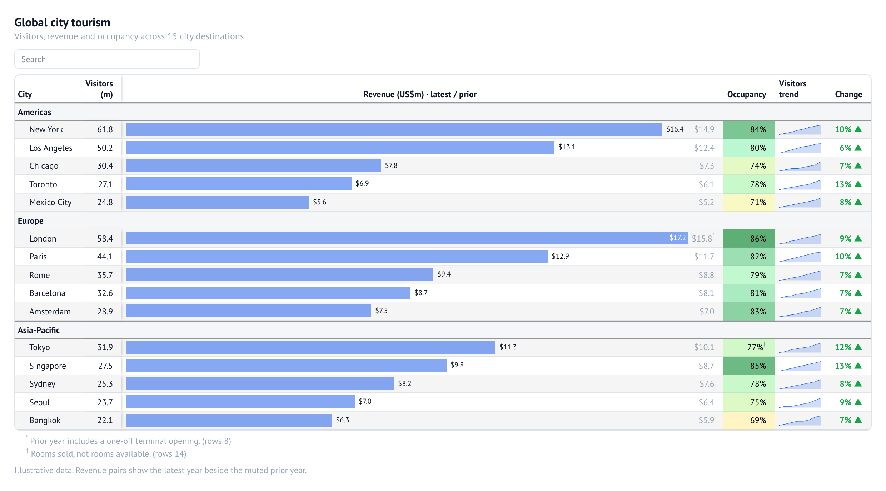
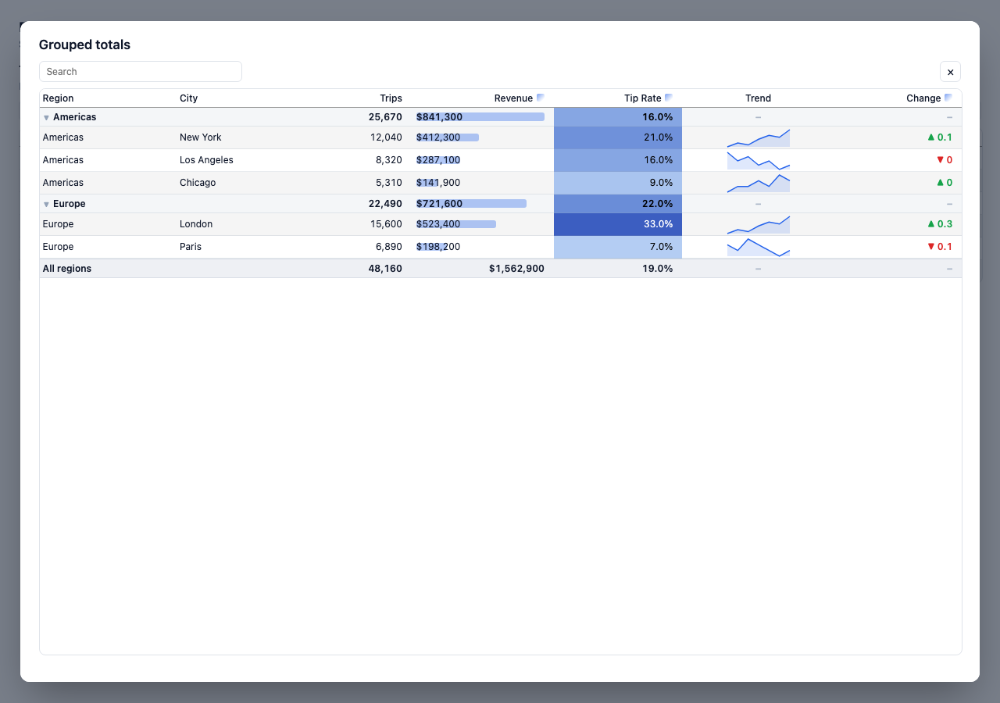
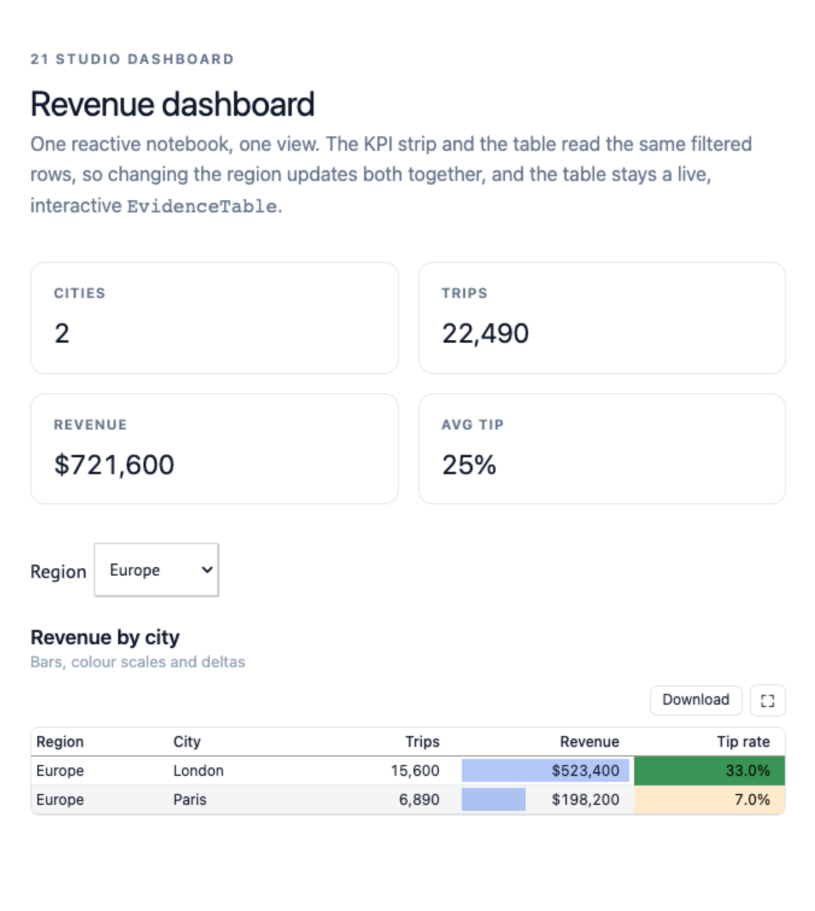

# marimo-evidence-tables

Evidence.dev-style interactive data tables for [Marimo](https://marimo.io),
packaged as an [anywidget](https://anywidget.dev) and powered by
[DuckDB](https://duckdb.org).

The goal is to bring the flexibility of Evidence's `DataTable` to Python
notebooks: rich cell formatting, conditional bars/colours/sparklines/deltas,
collapsible grouped subtotals, frozen columns, search, pagination, CSV export
and a fullscreen view — all driven from ordinary Python data.

It is a **display** widget with a clean division of labour: SQL (or pandas /
Arrow / records) shapes the data, Python describes how to present it, and the
browser renders it. The same table can be embedded in a Marimo app or placed in
a [marimo Studio](https://marimo.io/blog/introducing-marimo-studio) view, so one
notebook can serve a live dashboard, a report and a slide deck.

> **Status:** alpha (`0.1.0`), not yet published on PyPI — install from a
> checkout (see [Install](#install)). The API may change.

## Documentation

- [Design & DX](docs/design-and-dx.md) — *why* the table works the way it does,
  and what it borrows from Evidence, gt/Great Tables and A List Apart.
- [Technical architecture](docs/technical-architecture.md) — the wire format,
  render pipeline and diagrams.
- [marimo Studio views](docs/marimo-studio.md) — reuse notebook components in a
  view, with runtime guidance and troubleshooting.
- [Architectural Decision Records](docs/adr/README.md) — the decisions behind it.



Click the expand button (⛶) to fill the browser viewport. The expanded dialog
recomputes the page size to fit the available height (and re-fits on resize,
restoring your configured `page_size` on exit). It uses an opaque `Canvas`
surface (so it follows light/dark mode) over a dimmed backdrop, and can be
themed with `theme={"surface": "#0b1220"}`.



## Features

- **Rich formatting** — Excel-style format codes via `ssf` (`usd2`, `pct1`,
  `num0k`, `mmm-yy`, `#,##0.0`, …) plus auto-scaling `num`/`usd`/`eur`/`pct`
  base formats that pick units (`k`, `M`, `B`) from the data range.
- **Conditional visualisations** — `viz="bar"`, `viz="color"` (heatmap with
  custom colour scales, stops, midpoints and conditional-colour columns),
  `viz="sparkline"` (line/area/bar from an array in a cell, incl.
  `ARRAY_AGG({'date': ..., 'value': ...})`), and `viz="delta"`.
- **Grouped tables** — `grouped_table` runs one DuckDB `GROUPING SETS` query
  and produces collapsible groups, subtotals and a grand total.
- **Hierarchical columns** — `column_groups={"Payment type": ["credit_card",
  "cash"]}` wraps columns under shared headers and clusters them together.
- **Live tables** — `LiveEvidenceTable` re-runs a parameterised query when its
  controls change, preserving sort/search/page state.
- **Interaction** — 3-state column sorting, search, pagination (press and hold
  the prev/next buttons: after 700ms it pages every 700ms, easing to every
  100ms by 3 seconds), row links, clickable rows, sticky/frozen columns,
  resizable fullscreen dialog and CSV download.
- **Presentation** — titles/subtitles, column groups, row shading, row lines,
  text wrapping, red-negative values and per-column alignment.
- **Data sources** — Arrow tables, pandas DataFrames, DuckDB relations, plain
  records, and S3 Tables (Iceberg REST) through DuckDB.

## Install

The package is not on PyPI yet. From a checkout:

```bash
uv sync                  # Python dependencies (incl. dev tools)
make frontend-install    # JavaScript build/test dependencies
make frontend-build      # bundle table.js / table.css into the package
```

To use it from another project, add the local path:

```bash
uv add evidence-tables --path /path/to/marimo-evidence-tables
```

Optional extras: `evidence-tables[duckdb]` (DuckDB, Arrow, pandas),
`evidence-tables[marimo]`, and `evidence-tables[studio]` (marimo Studio). The
repository uses [`uv`](https://docs.astral.sh/uv/); `make` with no arguments
lists every available target.

## Quick start

```python
import duckdb
from evidence_tables import EvidenceTable

con = duckdb.connect()
con.execute("INSTALL httpfs; LOAD httpfs;")
con.execute(
    """
    CREATE VIEW trips AS SELECT * FROM read_parquet(
        'https://d37ci6vzurychx.cloudfront.net/trip-data/yellow_tripdata_2024-01.parquet'
    )
    """
)

EvidenceTable(
    con.sql("SELECT * FROM trips LIMIT 5000"),
    title="Recent yellow taxi trips",
    search=True,
    page_size=15,
    row_shading=True,
    freeze_columns=2,
    column_config={
        "trip_distance": {"fmt": "num1", "viz": "bar"},
        "fare_amount": {"fmt": "usd2"},
        "tip_rate": {
            "fmt": "pct1",
            "viz": "color",
            "color_scale": ["#fee2e2", "#fef9c3", "#bbf7d0", "#15803d"],
            "color_options": {"midpoint": 0.15, "min": 0, "max": 0.4},
        },
    },
)
```

In Marimo, display the widget directly or wrap it with
`mo.ui.anywidget(EvidenceTable(...))` when you want to read state back.

### Inferred defaults

Columns are typed from the source schema (DuckDB, Arrow, pandas) or from the
first values. The type picks sensible defaults that `column_config` can
override:

| Data type | `type` | default `fmt` | alignment |
| --- | --- | --- | --- |
| `INTEGER` / `BIGINT` | `number` | `num0` | right |
| `DECIMAL(p, s)` | `number` | `num{s}` | right |
| `DOUBLE` / `FLOAT` | `number` | auto (`num`/`usd`/`pct` scaling) | right |
| `DATE` / `TIMESTAMP` | `date` | date | left |
| `VARCHAR` | `string` | — | left |
| `BOOLEAN` | `boolean` | — | left |
| `LIST` | `array` | — | left |
| `STRUCT` / `MAP` | `object` | — | left |

So a DuckDB `count(*)` column renders as a whole number (`25,670`) with no
configuration. Integers default to `num0`; set `fmt="num"` to restore the
auto-scaling format (e.g. `26k`). DuckDB result types come back both as
`relation.types` and in the Arrow schema — the Arrow schema is what drives this.

DuckDB column comments come through too. A **table or view relation**
(`con.table("trips")`, including `.limit()` / `.filter()` / `.select()`)
surfaces `COMMENT ON COLUMN` text as the header description (the ⓘ tooltip). A
raw `con.sql(...)` result becomes an unnamed relation that no longer knows its
source, so pass `duck.column_comments` explicitly:

```python
from evidence_tables import EvidenceTable, duck

comments = {name: {"info": text} for name, text in duck.column_comments(con, "trips").items()}
EvidenceTable(con.sql("SELECT * FROM trips LIMIT 500"), column_config=comments)
```

**Arrow field metadata** works the same way, and is how a column description
survives **Parquet** and **Feather**: PyArrow writes the Arrow schema (including
field metadata) into the file's `ARROW:schema` key-value entry, so
`EvidenceTable(pq.read_table("orders.parquet"))` shows a `comment` /
`description` / `info` field metadata value as the header description. Parquet
itself has no standard per-column comment field: descriptions ride along in the
Arrow schema, file-level key/value metadata is available via
`parquet_kv_metadata()`, and DuckDB's `read_parquet` does not surface either.
You can also set one directly:
`column_config={"revenue": {"comment": "Net revenue in USD"}}` (`info` and
`description` also work).

## Grouped tables with subtotals

`grouped_table` builds the SQL for you. Pass a base query, the dimensions to
group by, and aggregate expressions:

```python
from evidence_tables import grouped_table

grouped_table(
    con,
    "SELECT * FROM trips",
    dimensions=["payment", "is_weekend"],
    measures=[
        "count(*) AS trips",
        "round(sum(total_amount), 0) AS revenue",
        "round(avg(tip_rate) * 100, 1) AS avg_tip_pct",
    ],
    total_label="All trips",
    subtotal_position="top",
    title="Trips by payment type",
    collapsible=True,
    dimension_config={"is_weekend": {"title": "Weekend"}},
    measure_config={
        "revenue": {"fmt": "usd0", "viz": "bar"},
        "avg_tip_pct": {"title": "Avg tip %", "fmt": "num1"},
    },
)
```

Measures may be strings (`"sum(x) AS total"`), `(alias, expression)` tuples, or
`{alias: expression}` mappings. The resulting table is a normal `EvidenceTable`
with `render_type` (`cell_data` / `row_subtotal` / `row_total`) and grouping
metadata on each row.

### Aggregations for subtotals/totals

By default subtotals re-run the measure's SQL aggregate. `aggregations`
recomputes them from the detail values (Evidence's `totalAgg`) using built-in
names or any Python callable:

```python
import statistics
from evidence_tables import grouped_table, BUILTIN_AGGREGATIONS

grouped_table(con, sql, ["category", "item"], ["sum(sales) AS sales"],
              aggregations={"sales": "mean"})        # sum, mean, median, min,
                                                     # max, count, count_distinct,
                                                     # weighted_mean

grouped_table(..., aggregations={"sales": statistics.median})
grouped_table(..., aggregations={"sales": lambda values: max(values) - min(values)})
grouped_table(..., aggregations={"sales": "weighted_mean"},
              weight_columns={"sales": "weight"})
```

`total_measures={"sales": "avg(sales)"}` is also available for a direct SQL
override of the grand total. See `notebooks/14_aggregations.py`.

### Client-side grouping

For rows already in Python (a list of dicts, a DataFrame, …), `grouped_records`
does the same grouping without a database — Evidence's legacy `groupBy`:

```python
from evidence_tables import grouped_records

grouped_records(sales, group_by=["region", "category"],
                measures=["sales", "orders"], aggregations={"sales": "mean"},
                group_type="section")
```

See `notebooks/15_client_grouping.py`.

## Presentation parts

A display table is more than its data — gt calls the surrounding pieces the
*table parts*: a header, row labels, column labels/spanners, the body, and a
footer with footnotes and source notes. `EvidenceTable` covers:

- **Section dividers** — put `section_row("Label")` anywhere in `rows` for a
  full-width divider row.
- **Footnotes** — point a column at a footnote column with
  `column_config={"Intel": {"footnote": "intel_note"}}`. Cells then show a
  superscript mark and the footer lists each unique note with the rows it
  appears on (`rows 6, 14`, compressed to ranges for hierarchical tables).
  `footnotes=["..."]` adds static notes.
- **Caption / source notes** — `caption="Sources: ..."`.
- **Nested spanners** — `column_group` accepts a list for multi-level headers:
  `{"name": "sales", "column_group": ["2021", "Sales"]}`.
- **Stub** — `stub="product"` marks the row-label column and `stub_head` labels it.
- **Markdown titles** — `title`/`subtitle`/`caption` support inline `**bold**`,
  `*italic*` and `` `code` ``.
- **Blanking / cutoffs** — `null_text=""` renders nulls as truly blank (the
  default is `–`); `blank_below` / `blank_above` suppress values outside a
  range; a Python `blank=lambda value: ...` predicate blanks individual cells.
- **Readable typography** — text is left-aligned and numbers right-aligned by
  default, headings follow their column, and figures are **lining** tabular
  numerals (so a font that defaults to oldstyle/lowercase figures is corrected;
  override with `figure_style="oldstyle"|"proportional"|…`). `stretch=False`
  sizes columns to their content ("don't stretch tables"), and
  `align_decimals=True` pads each numeric column to a common precision so the
  decimal points line up. `row_lines=False` / `row_shading=False` keep the
  furniture minimal. See `notebooks/19_typography.py`.
- **Grouping with white space or stripes** — `group_gap=True` adds room around
  group boundaries, `section_row(...)` inserts full-width dividers, and
  `row_shading` accepts `True` (alternating), an integer for groups of *n*
  (e.g. `3` = three shaded, three unshaded), or `[shaded, unshaded]`. See
  `notebooks/20_whitespace_grouping.py`.
- **Rotated headings** — `rotate_titles="vertical"` (90° counter-clockwise) or a
  number for oblique headings (e.g. `-60`). The stub is not rotated by the
  table-level setting; per-column `rotate_title` overrides. Oblique headings
  anchor bottom-left, auto-size the header height, and reserve right padding so
  they are not clipped.

### Location-based rules (gt's `tab_style` / `tab_format` / `text_transform`)

Target sets of cells with `cells_body(columns, rows)`, where `rows` is 0-based
indices or a Python predicate on the row. Rules run in order; the last match
wins.

```python
from evidence_tables import EvidenceTable, cells_body, tab_style, tab_format, text_transform

EvidenceTable(
    data,
    rules=[
        tab_style(
            cells_body(columns=["sales"], rows=lambda r: r["sales"] < r["prior"]),
            background="#fee2e2", color="#b91c1c", font_weight="600",
        ),
        tab_format(cells_body(columns=["revenue"]), "usd0"),
        text_transform(cells_body(columns="code"), str.upper),
    ],
)
```

See `notebooks/16_tech_giants.py` and `notebooks/17_gt_features.py`.

### Merging, substitutions and special formatters (Great Tables-inspired)

- **Column merging** — combine source columns into one rendered column; the
  sources can be hidden helper columns built in SQL:
  `cols_merge_range("low", "high", fmt="num0")`,
  `cols_merge_uncert("value", "uncert")`, `cols_merge_n_pct("n", "pct")`, or a
  raw `cols_merge("{a}–{b}", template_fmt={"a": "num0"})`.
- **Substitutions** — replace values at display time: `sub_missing`,
  `sub_zero`, `sub_small_vals`, `sub_large_vals`, `sub_values`.
- **Special formatters** — format codes `bytes`, `duration`, `roman`, `flag`,
  and a cell `markdown` option.
- **Options** — `footnote_marks` (`numbers`/`letters`/`symbols`), `all_caps`.

See `notebooks/18_great_tables.py`.

## Live, parameterised tables

`LiveEvidenceTable` keeps a parameterised query and re-runs it when its
controls change, without recreating the widget — so sort, search and page state
survive. In Marimo, keep the widget persistent and let a reactive cell drive it:

```python
# controls
min_fare = mo.ui.slider(0, 80, value=10, label="Minimum fare")
min_fare

# persistent widget (created once; no control references)
live = LiveEvidenceTable(
    con,
    "SELECT * FROM trips WHERE fare_amount >= {min_fare}",
    auto_run=False,
)
live

# reactive cell: re-runs whenever the slider changes
_ = live.set_controls(min_fare=min_fare)
```

Values from `params` / `set_controls` are bound as SQL parameters, never spliced
into the SQL text. Updates run in place: fast queries swap the rows in without
flashing, while slow ones keep the current table on screen and fade it into a
dimmed “Processing…” state over 0.6s, then reveal the new data immediately. The
table keeps a stable height throughout.

Outside a reactive host, `bind_controls=True` makes the widget re-run itself on
control changes. `query_values(con, sql)` returns one column as a list, handy
for populating dropdowns/multiselects from dimension queries. See
`notebooks/03_live_drilldown.py` and `notebooks/04_live_demo.py`.

> **Important:** the cell that creates the widget must **not** reference the
> controls. Referencing a control registers a Marimo dependency, so wrapping
> the widget and its controls in the same `mo.vstack([controls, live])` makes
> that cell re-run on every change and recreate the widget — the table then
> disappears and reappears. Display controls in their own cell instead.

### Auto-refresh

Evidence's `refresh_interval` is notebook-level in Marimo: combine
`mo.ui.refresh` with a live table in the reactive cell.

```python
refresh = mo.ui.refresh(options=["5s", "30s"], default_interval="30s")
refresh

# reactive cell
if refresh.value is not None:
    live.run(sql)
```

## marimo Studio views

[marimo Studio](https://marimo.io/blog/introducing-marimo-studio) gives one
notebook named views — a dashboard, article, slide deck or PDF — each its own
frontend project. A view does not copy your code: it **projects** the notebook's
cells, outputs and values by name, so the same `EvidenceTable`, controls and
KPIs can back several views and stay in sync with the notebook.



### Reuse notebook components in a view

1. **Put each reusable component in its own named cell.** The cell function name
   becomes its projection target.

   ```python
   @app.cell
   def revenue_table(EvidenceTable, filtered):        # target: "revenue_table"
       EvidenceTable(filtered, title="Revenue by city", column_config={...})
   ```

   ```python
   @app.cell
   def kpis(filtered):                                # value: "kpis"
       kpis = {"revenue": ..., "trips": ...}
       return (kpis,)
   ```

2. **Create a view** next to the notebook (Studio toolbar → **Add view**, or the
   CLI). Views live in a committed `view_root`, so they can be versioned with the
   notebook:

   ```console
   uv run --with "marimo-studio[deno]" marimo-studio view create dashboard --target analysis.py
   ```

3. **Project the components by name** from the view's `index.html`:

   ```html
   <marimo-cell name="revenue_table"></marimo-cell>   <!-- live EvidenceTable -->
   <marimo-cell name="region_filter"></marimo-cell>   <!-- native marimo control -->
   <strong mo-value="kpis.revenue"></strong>          <!-- one value, as data -->
   ```

| Goal | Element | Example |
| --- | --- | --- |
| Show a cell's output, live (table, chart, control) | `<marimo-cell name="…">` | `<marimo-cell name="revenue_table">` |
| Show one object, even one the notebook never displays | `<marimo-output name="…">` | `<marimo-output name="summary">` |
| Read one value into the view's own markup or JS | `mo-value="…"` | `mo-value="kpis.revenue"` |

The notebook owns data and computation; the view owns presentation. The same
component can be projected into any number of views, and changing a control in
one view re-runs the notebook and updates every dependent result.

**Reuse the widget, or reuse the data.** Project the cell (above) to reuse the
live `EvidenceTable` with all its interaction. Project `mo-value="filtered"` to
reuse only the rows and draw them in the view's own markup — the pattern the
demo's `report` view uses, which also works in a static (Prepared) export. The
[demo](notebooks/21_studio_dashboard.py) ships both.

### Run the demo

[`notebooks/21_studio_dashboard.py`](notebooks/21_studio_dashboard.py) is a
self-contained notebook (no database, no network) with two committed views under
`notebooks/studio/21_studio_dashboard/`:

```console
make studio-serve        # opens the notebook with Studio installed
make studio-validate     # validates every committed view against the notebook
```

Because the table is interactive, the views use Studio's **Server** runtime. A
static (`Prepared`) or browser (`wasm`) export additionally needs
`evidence-tables` on PyPI. See [docs/marimo-studio.md](docs/marimo-studio.md)
for the full recipes, runtime guidance, projection size limits and
troubleshooting.

## Amazon S3 Tables

`evidence_tables.duck` can attach an S3 Tables Iceberg catalog to DuckDB using
your ambient AWS credentials:

```python
from evidence_tables import duck

con = duck.connect_s3_tables(table_bucket_arn="arn:aws:s3tables:...:bucket/...")
con.sql("SELECT * FROM s3tables.taxi.yellow_trips LIMIT 100")
```

See `notebooks/02_s3_tables.py` for a full example (it gracefully stops if
`S3TABLES_TABLE_BUCKET_ARN` is not set).

## API

### `EvidenceTable(data=..., *, columns=None, column_config=None, column_groups=None, **options)`

- `data`: records, Arrow table, pandas DataFrame, or DuckDB relation.
- `columns`: optional list of column definitions (dicts or names).
- `column_config`: `{column_name: {overrides}}` merged onto inferred columns.
- `column_groups`: `{group_title: [column, ...]}` renders the listed columns
  under a shared header and clusters them together (ungrouped columns keep
  their place). Equivalent to setting `column_group` on each column; disable
  clustering with `order_columns_by_group=False`.
- `options`: table-level display options (below).
- Methods: `set_data(...)`, `update_options(...)`, `set_column(name, ...)`.
- Constructors: `from_records`, `from_arrow`, `from_pandas`, `from_duckdb`.

### Column definition

| Key | Description |
| --- | --- |
| `name`, `title` | Row key and display title. |
| `type` | `string`, `number`, `date`, `boolean`, `array`, `object`. |
| `fmt` | Format code or preset (`usd2`, `pct1`, `num1m`, `mmm-yy`, …). |
| `fmt_column` | Column of format codes used per row. |
| `total_fmt`, `subtotal_fmt` | Format codes for total/subtotal rows. |
| `null_text` | Text for null/cut-off cells (default `–`; use `""` for blank). |
| `blank_below`, `blank_above` | Treat numeric values outside the range as blank. |
| `blank` / `blank_if` | Python callable `value -> bool`; `True` blanks the cell. |
| `footnote`, `footnote_column` | Column of footnote text; cells show a superscript and the footer lists notes with their rows. |
| `align` | `left`, `right`, `center` (defaults by type). |
| `font` | Font family for this column (e.g. `"'Hoefler Text', serif"`). |
| `figure_style` | `lining-tabular` (default), `oldstyle`, `proportional`, … |
| `wrap`, `hide`, `red_negatives` | Layout / value tweaks. |
| `viz` | `bar`, `color`, `sparkline`, `delta`, or `None`. |
| `bar_options` | `bar_color`, `bar_color_negative`, `hide_labels`, `fit_to_data`. |
| `color_options` | `color_scale`, `color_stops`, `conditional_colors`, `scale_column`, `scale_mode`, `min`, `max`, `midpoint`. |
| `delta_options` | `down_is_good`, `show_symbol`, `symbol_position`, `neutral_range`. |
| `sparkline_options` | `type` (`line`/`area`/`bar`), `x`/`y` (field names for struct arrays), `color`, `fit_to_data`, `width`, `height`, `y_fmt`. |
| `link`, `link_label`, `link_new_tab` | Per-cell links. |
| `html`, `image`, `image_options`, `logo` | Custom cell content (HTML, image URL, or logo.dev domain). |
| `footnote` | Name of a column whose value is this cell's footnote text. |
| `info` (`comment`, `description`) | Header description, shown as an immediate **ⓘ** tooltip. |
| `column_group`, `repeat_values`, `viz_include_subtotals` | Additional metadata. |

### Table options

`title`, `subtitle`, `info`, `info_link`, `info_link_title`, `search`,
`page_size`, `sortable`, `download`, `row_shading`, `row_lines`,
`freeze_columns`, `wrap`, `wrap_titles`, `format_titles`, `show_total_row`,
`total_label`, `total_position`, `subtotal_position`, `collapsible`,
`collapsed`, `link`, `width`, `max_height`, `order_columns_by_group`, `theme`,
`color_scale`.

## Architecture

Three reference documents go with the code:

- [**Design & DX**](docs/design-and-dx.md) — *why* the table works the way it
  does, the DX principles, and what we borrowed from Evidence, gt/Great Tables
  and A List Apart.
- [**Technical architecture**](docs/technical-architecture.md) — *how* it is
  implemented, with the wire format, render pipeline and diagrams.
- [**Architectural Decision Records**](docs/adr/README.md) — the dated, MADR-
  format record of each decision, its alternatives and its consequences.

The widget has two halves:

- **Python** (`src/evidence_tables/`) normalises data into JSON-serialisable
  `rows`, `columns` and `options` traitlets. `data.py` handles type inference
  and Arrow/Decimal/date conversion; `grouped.py` builds the `GROUPING SETS`
  SQL and the row metadata; `duck.py` manages DuckDB connections, S3
  credentials and the S3 Tables catalog.
- **JavaScript** (`frontend/src/`, bundled to `src/evidence_tables/static/`)
  is a dependency-light vanilla renderer. `format.js` ports Evidence's
  `formatValue` (on `ssf`), `color.js` ports its chroma-based colour scales,
  and `table.js` owns rendering, sorting, search, grouping, frozen columns,
  fullscreen and CSV export.

The bundle is committed so the Python package works with no JS toolchain.
Rebuild it with `make frontend-build` after editing `frontend/src/`.

## Development

```bash
make install          # Python (incl. dev tools) + JavaScript dependencies
make install-hooks    # install the pre-commit hooks
make lint             # ruff · bandit · pip-audit · pyrefly · shellcheck · checkmake · rumdl
make format           # auto-fix formatting and lint issues
make test             # Python tests (with coverage) + JavaScript tests
make test-browser     # Playwright functional tests (installed Edge/Chrome)
make check-notebooks  # marimo check on every notebook
make check-artifact   # build a wheel/sdist and verify their contents
make validate         # lint + notebook checks + tests + build
make run-marimo       # open the notebooks
make screenshot       # render frontend/preview.html to /tmp/evidence_preview.png
```

The quality gates are mirrored in two places so they cannot drift:
`[.pre-commit-config.yaml](.pre-commit-config.yaml)` (on commit) and
`[scripts/lint.sh](scripts/lint.sh)` (locally and in CI). Repository-workflow
tests in `tests/release/` assert the gates actually fail when a tool fails and
that the shipped wheel contains the committed renderer assets.

## Relationship to Evidence

This project is a focused reimplementation for the Python/Marimo ecosystem.
The formatting presets, colour-scale maths and overall table presentation are
ported from Evidence's `formatValue`, `table-viz`, `table-styles` and
`color-scale-utils` modules. Evidence is MIT licensed; the same license applies
here.

## Roadmap

- Pivoted columns (measures across a pivot dimension).
- Column comparisons (period-over-period) and comparison tooltips.
- Excel export.
- Virtualised rendering for very large result sets.

## License

MIT.
