# The `evidential` API

`evidential` gives you Evidence-style tables inside a Marimo notebook (or any
anywidget host). You point it at data, describe the columns you want with a
small fluent builder, and it renders a sortable, searchable, exportable table.

This is the reference for the **current** API. It is written around the three
things you actually compose:

1. **Columns** — `col.<kind>("name", ...)` and the chain that refines it.
2. **Header structures** — groups and sub-columns, built from columns.
3. **Derived values** — merged columns and the grouped / pivot / comparison
   helpers, which reuse the same column builder.

Every screenshot in this document is produced by
[`scripts/api_screenshots.py`](../../scripts/api_screenshots.py); re-run it with
`uv run python scripts/api_screenshots.py` after changing an example.

- [Quick start](#quick-start)
- [The fluent column builder](#the-fluent-column-builder)
  - [Kinds](#kinds-the-chain-entry-points)
  - [The chain](#the-chain)
  - [How a column composes](#how-a-column-composes)
- [Composing header structures](#composing-header-structures)
  - [Columns](#columns)
  - [Groups](#groups)
  - [Sub-columns](#sub-columns)
  - [Nesting](#nesting)
- [Composing merged values](#composing-merged-values)
- [Grouped, pivot and comparison tables](#grouped-pivot-and-comparison-tables)
- [Table settings](#table-settings)
- [Visualisations](#visualisations)
- [Formatting](#formatting)
- [Reference](#reference)

## Quick start

```bash
uv add evidential
```

```python
from evidential import EvidentialTable, col, settings

rows = [
    {"city": "Boston", "trips": 1284, "revenue": 48120.50, "tip_rate": 0.183},
    {"city": "New York", "trips": 3502, "revenue": 142880.25, "tip_rate": 0.171},
    {"city": "Chicago", "trips": 2118, "revenue": 76540.00, "tip_rate": 0.164},
    {"city": "San Francisco", "trips": 1907, "revenue": 98320.75, "tip_rate": 0.196},
    {"city": "Seattle", "trips": 1463, "revenue": 61140.10, "tip_rate": 0.188},
]

EvidentialTable(
    rows,
    columns=[
        col.text("city", title="City"),
        col.integer("trips", title="Trips"),
        col.currency("revenue", title="Revenue"),
        col.percent("tip_rate", decimals=1, title="Tip rate"),
    ],
    settings=settings(
        title="Tipping by city",
        caption="Illustrative sample orders.",
        width="620px",
    ),
)
```

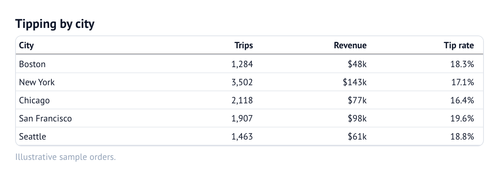

In Marimo, wrap it in a widget cell: `mo.ui.anywidget(EvidentialTable(...))`.
The cell that *creates* the widget must not read any control values — see
[`docs/design-and-dx.md`](../design-and-dx.md).

`EvidentialTable` accepts a pandas DataFrame, a PyArrow Table, a list of dicts
(via `rows=`), or a DuckDB connection with SQL (through the helpers below). You
can also pass `columns=` as an ordered list of names, or omit `columns` entirely
and let the renderer infer a column set from the data.

## The fluent column builder

A column is built in two moves:

```python
from evidential import col

(
    col.percent("growth", decimals=1)  # 1. the factory — names the kind
    .bar(center=True)                  # 2. the chain — refines it
    .neg(bracket=True)
)
```

- The **factory** (`col.*`) names the column's *kind*: a number, a currency, a
  percentage, a date, a flag, a bar, a chip, a rating, … This is the first
  decision, so it is the first thing you write, and `col.` autocompletes to
  exactly these entry points.
- The **chain** (`.bar(...)`, `.neg(...)`, `.bold()`, `.fmt(...)`, …) refines the
  baseline the factory set.

The result is a `Column`: an immutable `Mapping[str, Any]` in the widget's wire
format. `dict(column)` or `column.to_config()` returns the plain dict, which is
what the classic (non-fluent) API accepted — the two are interchangeable.

### Kinds (the chain entry points)

Each factory sets a sensible `type`, format and alignment for the kind. The
kind is the *starting point*; anything it sets can be overridden later.

| Factory | Kind | Baseline it sets |
| --- | --- | --- |
| `col.text(name)` | free text | `type="string"`, left |
| `col.number(name, fmt=, align=)` | a number | `type="number"`, auto-scaling |
| `col.integer(name)` | a whole number | `type="number"`, `num0` |
| `col.percent(name, whole=, decimals=)` | a percentage | `pct1` (or `0.0"%"` when `whole=True`) |
| `col.currency(name, code=, decimals=)` | money | `usd`, `eur`, `gbp`, … |
| `col.boolean(name)` | true/false | `type="boolean"` |
| `col.date(name)` | a date | `type="date"`, `yyyy-mm-dd` |
| `col.time(name)` | a time of day | `type="date"`, `hms` |
| `col.datetime(name)` | date and time | `type="date"`, `yyyy-mm-dd HH:MM:SS` |
| `col.flag(name)` | a country/region | `fmt="flag"` (alpha-3 codes) |
| `col.bar(name)` | a bar | `viz="bar"` |
| `col.color(name)` | a shaded cell | `viz="color"` |
| `col.chip(name)` | a pill | `viz="chip"` |
| `col.delta(name)` | a change indicator | `viz="delta"` |
| `col.sparkline(name)` | an array trend | `viz="sparkline"` |
| `col.symbols(name)` / `col.repeat` | repeated symbols | `viz="symbols"` |
| `col.rating(name, max=)` | a star rating | `viz="symbols"`, `★`/`☆` |
| `col.link(name)` / `col.url` | a hyperlink | `html` + link |
| `col.image(name)` / `col.logo` | an image | `html` + `` |
| `col.markdown(name)` / `col.html` | rich text | `html` |
| `col.auto(name, **overrides)` | *inferred* | see [inference](#the-inferred-kind-colauto) |
| `col.merge(name, spec)` | a merged column | see [merged values](#composing-merged-values) |

`col.group(...)` and `col.subcolumns(...)` are **structures**, not leaf columns —
see [Composing header structures](#composing-header-structures).

### The chain

Every method returns a **new** `Column`; the original is never mutated. That is
what makes the chain safe to store, reuse and extend.

| Method | Effect |
| --- | --- |
| `.fmt(code)` / `.format(code)` | set the SSF format code (the escape hatch) |
| `.total_fmt(code)` / `.subtotal_fmt(code)` | a different format in the total / subtotal rows |
| `.align("left"\|"right"\|"center")` | horizontal alignment |
| `.align_decimals(bool)` | pad decimals so points line up |
| `.title(text)` / `.info(text)` / `.footnote(column)` | header text, tooltip, footnote mark |
| `.bold()` / `.italic()` / `.font_weight(v)` / `.font_style(v)` | body-cell font |
| `.font(family)` / `.font_color(color)` | body-cell family and colour |
| `.wrap(bool)` / `.rotate_title(deg)` | wrapping and rotated headers |
| `.neg(color=, bracket=)` / `.red_negatives()` | negative-number styling |
| `.highlight(color)` | tint the whole column |
| `.blank(pred)` / `.blank_below(v)` / `.blank_above(v)` / `.null_text(t)` | suppress values |
| `.repeat_values(bool)` / `.hide(bool)` / `.sort_by(column)` | grouping display, visibility, sort key |
| `.markdown()` / `.html()` / `.link(...)` / `.image(...)` / `.logo(...)` | rich cells |
| `.template(value, **formats)` | a fill-in-the-blanks cell |
| `.viz(kind, **options)` | set `viz` directly |
| `.bar(...)` / `.color(...)` / `.chip(...)` / `.delta(...)` / `.sparkline(...)` / `.symbols(...)` | visualisations |
| `.relative(value)` / `.fmt_column(column)` / `.group(label)` / `.subcolumn(label)` | dates, references, header structure |

### How a column composes

Every factory call and every chain method merges a small dict of options into a
new `Column`. Options **accumulate** and the **last write wins**, so the chain
reads top-to-bottom as "start here, then…".

```python
col.currency("revenue", decimals=0).bar().neg(bracket=True).bold()
```

builds up like this:

```python
step_1 = {"name": "revenue", "type": "number", "fmt": "usd0"}           # col.currency(...)
step_2 = {**step_1, "viz": "bar"}                                          # .bar()
step_3 = {**step_2, "red_negatives": True, "bracket_negatives": True}     # .neg(bracket=True)
step_4 = {**step_3, "font_weight": "600"}                                  # .bold()
```

and `to_config()` returns the merged result:

```python
{
    "name": "revenue",
    "type": "number",
    "fmt": "usd0",
    "viz": "bar",
    "red_negatives": True,
    "bracket_negatives": True,
    "font_weight": "600",
}
```

Because a column is just a mapping, the reverse also works: build the dict
yourself and hand it to `columns=[...]` — the renderer treats the two
identically.

#### The inferred kind: `col.auto`

If a spec has **no `type`**, it does not retype the column — it takes the
*inferred* definition and then applies its own options on top. `col.auto` is the
explicit spelling of that:

```python
[col.auto("trips"), col.auto("revenue").font_color("#94a3b8")]
```

This is how you keep DuckDB/Arrow types and column metadata while still tweaking
alignment, colour or a visualisation. A bare name (`col.auto("x")` ≡ `"x"`) and
a mapping without a `type` behave the same way. Aliases are normalised *before*
the merge, so an inferred default (e.g. `redNegatives: false`) never shadows a
camelCase option you set.

## Composing header structures

Tables are trees, not just rows of columns. Three builders express the tree, and
they all flatten into the same flat `columns=[...]` list.

### Columns

A `col.*` leaf is the only thing that renders body cells. Its `name` is the data
column it reads; everything else is presentation.

### Groups

`col.group(label, columns, *, highlight=None)` puts a **spanner** header over a
run of columns:

```python
col.group("Financials", [
    col.currency("revenue", title="Revenue"),
    col.currency("cost", title="Cost"),
    col.currency("profit", title="Profit"),
])
```

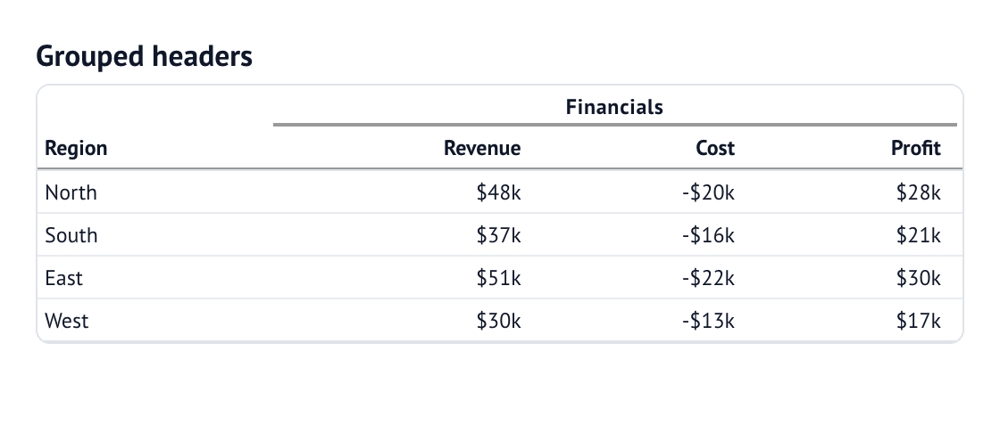

The label spans its members; the members keep their own headers and rendering.
`label` may be a list of strings to nest several levels at once, and `highlight`
tints the whole group.

### Sub-columns

`col.subcolumns(label, columns, *, group=None, highlight=None)` gives several
members **one shared leaf header**. This is for the reporting idiom of a value
beside its period — one right-aligned number, one muted left-aligned text, maybe
a chip — under a single heading:

```python
col.subcolumns("Latest", [
    col.number("gdp", fmt="num1", align="right").neg(),
    col.auto("quarter").align("left").font_color("#94a3b8"),
])
```

The shared header replaces the members' individual visible titles, and clicking
it sorts on the first visible member (`sort_by` on that member can pick a
different key). Each member is still its own data column for search, export,
statistics and runtime updates — only the header is shared.

### Nesting

Groups and sub-columns nest freely, which is how you get the two-level economic
table:

```python
col.group("Gross domestic product", [
    col.subcolumns("Latest", [
        col.number("gdp", fmt="num1", align="right").neg(),
        col.auto("quarter").align("left").font_color("#94a3b8"),
    ]),
    col.number("forecast", fmt="num1", align="right", title="Annual forecast"),
]),
col.group("Consumer prices", [
    col.subcolumns("Latest", [
        col.number("cpi", fmt="num1", align="right").neg(),
        col.auto("month").align("left").font_color("#94a3b8"),
    ]),
]),
```

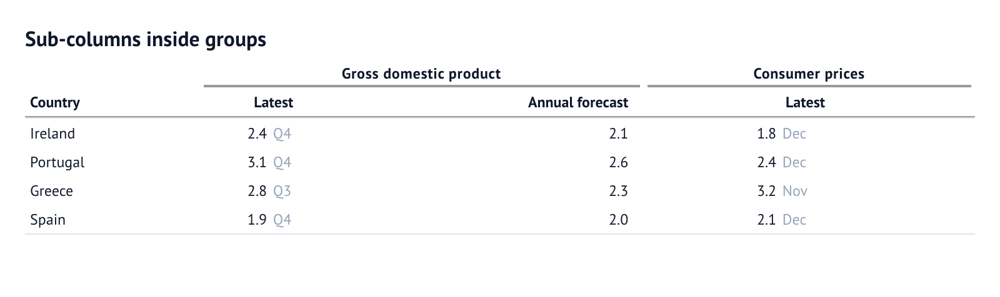

`col.group` and `col.subcolumns` both return a `ColumnGroup` — an immutable
`Sequence[Column]`. Because `columns=[...]` flattens nested sequences
recursively, a `ColumnGroup` can be dropped anywhere a list of columns is
expected, including inside another group.

## Composing merged values

A **merged column** is the opposite of a sub-column: instead of one header over
several cells, it is **one cell** built from several columns. The `cols_merge_*`
helpers describe the value; `col.merge(name, spec)` names the derived column:

```python
from evidential import col, cols_merge_n_pct, cols_merge_range, cols_merge_uncert

columns=[
    col.text("site", title="Site"),
    col.merge("range", cols_merge_range("low", "high", fmt="num0", title="Range")),
    col.merge("measurement", cols_merge_uncert("value", "uncert", fmt="num1", title="Value")),
    col.merge("share", cols_merge_n_pct("n", "pct", title="Share")),
]
```

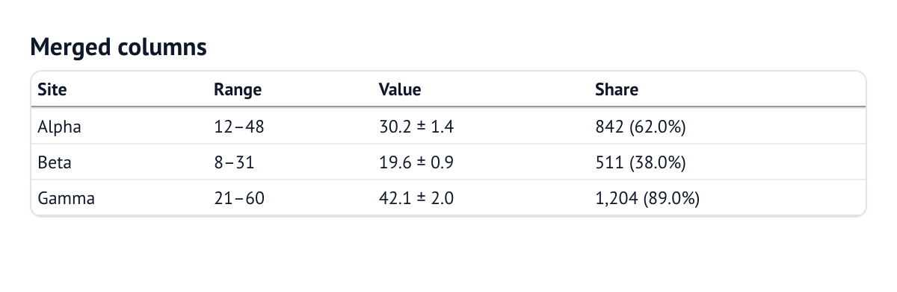

| Helper | Result |
| --- | --- |
| `cols_merge(template, *, template_fmt=, **options)` | a template filled from other columns |
| `cols_merge_range(begin, end, *, sep="–", fmt=)` | `"begin–end"` |
| `cols_merge_uncert(value, uncert, *, sep=" ± ", fmt=)` | `"value ± uncert"` |
| `cols_merge_n_pct(n, pct, *, fmt=, pct_fmt="pct1")` | `"n (pct)"` |

The first argument to `col.merge` is the name of the new column; the helper's
`**options` (including `title`) are merged onto it like any other column option,
so you can chain on the result too.

## Grouped, pivot and comparison tables

The aggregate helpers accept the same `col.*` builders — through
`dimension_config` / `measure_config` — so everything above applies unchanged.
They run their aggregation in DuckDB (`GROUPING SETS`), then hand a flat table to
the renderer.

```python
from evidential import col, grouped_table, pivot_table, comparison_table

grouped_table(
    connection,
    "SELECT category, sales FROM needful_things.orders",
    dimensions=["category"],
    measures=["round(sum(sales), 0) AS sales", "count(*) AS orders"],
    dimension_config={"category": col.text("category")},
    measure_config={
        "sales": col.currency("sales", decimals=0),
        "orders": col.integer("orders"),
    },
)
```

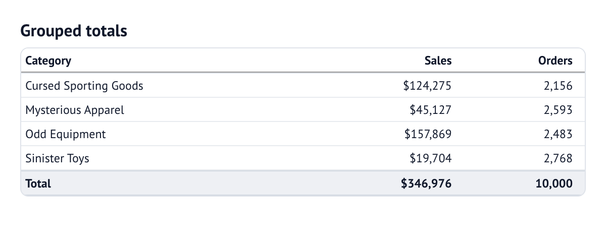

`pivot_table` turns a dimension into columns (each pivot value becomes its own
column per measure, under a shared header):

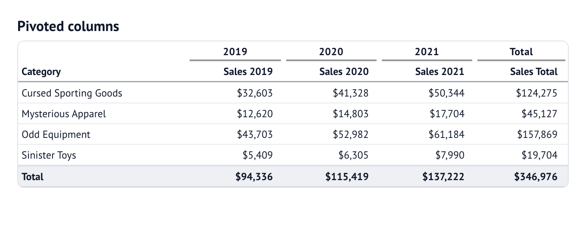

`comparison_table` computes each measure for the current and the matching prior
period, then adds `<measure>_prior`, `<measure>_delta` and `<measure>_pct`. The
percentage-change column is a `viz="delta"`; a measure's `delta_options` (or
top-level `neutral_range`, `down_is_good`) describe those derived columns. Use
`col.merge` when you want to name and style them explicitly.

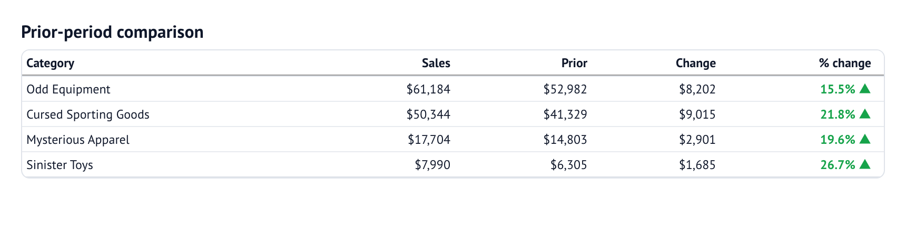

`query_table` runs ad-hoc SQL with optional `where` / `order` / `limit` /
`date_range` and lays the result out with your `columns`:

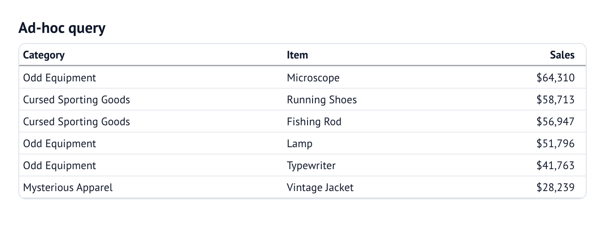

`grouped_records` does the same grouping client-side, from plain rows. For
report-specific synthetic rows — a section divider, a differently-labelled
summary, or values computed from a group's own rows — use the fluent `rows`
builder, whose `build()` returns rows for `EvidentialTable(rows=...)`:

```python
from evidential import rows

built = (
    rows.of(detail)
    .group_by("region")
    .section()
    .summary(label="Developing average",
             values={"arr": lambda group: sum(r["arr"] for r in group) / len(group)})
    .total(label="All regions")
    .build()
)
```

A `values` entry may be a callable, a built-in aggregation name (`"sum"`,
`"mean"`, …) or a literal; a summary or total without `values` sums the numeric
columns. Pass `combined=True` to the grouped helpers to put a group's label and
its subtotal in **one section row** instead of a separate header and summary. `section_row(label, align="center")`
inserts a full-width divider, centered if you ask; when a section spans a page,
the later page repeats it as `"<label> (cont.)"`. Rows are separated by the
`row_lines` rule: `True` (default grey), `False` (none), or a colour name
(`"black"`, `"grey"`, `"white"`).

## Table settings

`settings(**options)` validates a set of table-wide options and returns a
`TableOptions` mapping. Pass it with `settings=REPORT`, and let explicit keyword
arguments win over it:

```python
REPORT = settings(title="Monthly report", width="900px", row_shading=True)

EvidentialTable(rows, columns=[...], settings=REPORT, width="700px")  # width=700px
```

The same options can be passed directly to `EvidentialTable(...)`. The full set
is in the [Table options reference](#table-options).

## Visualisations

A visualisation is a column option (`viz`) plus a bag of options, set through a
chain method. Most visualisations are **presentations of a value**: sorting,
search, statistics and CSV export keep using the underlying number.

```python
columns=[
    col.text("region", title="Region"),
    col.bar("revenue", title="Revenue"),                    # a bar
    col.bar("growth", center=True, title="Growth"),         # a centred (diverging) bar
    col.color("share", title="Share"),                      # a shaded cell
    col.chip("region", title="Chip"),                       # a pill
    col.sparkline("trend", type="area", title="Trend"),     # a trend
    col.boolean("active", true_symbol="✓", false_symbol="✗"),  # ✓/✗
    col.percent("growth", decimals=0, title="Δ").delta(),   # a change indicator
]
```

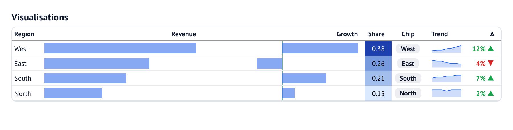

- **Bar** — `.bar(color=, negative_color=, fit_to_data=, hide_labels=,
  background=, center=, pad=, direction=, reference=, reference_color=,
  reference_label=)`. With `center=True` the bar grows from a centre line
  (positive right, negative left) — a second geometry of the same cell. With
  `direction="left"` it fills from the right edge instead, and `reference=N`
  draws a vertical benchmark rule at a value. `color="@column"` colours each bar
  from a column (`@` marks the column reference).
- **Colour** — `.color(scale=, stops=, conditional_colors=, scale_column=, min=,
  max=, midpoint=)`. `scale` takes a preset (`"blues"`, `"viridis"`), any of the
  matplotlib colour maps (`"RdBu"`, `"plasma"`, …), a list of stops, or
  `"@column"` to take each row's colour from another column.
- **Chip** — `.chip(min_width=, conditional_colors=, scale=, …)`, on either a
  text or a numeric column.
- **Delta** — `.delta(down_is_good=, neutral_range=, chip=, show_value=,
  show_symbol=, symbol_position=)`. Green for up, red for down, a grey dash
  inside `neutral_range`.
- **Sparkline** — `.sparkline(type="line"|"area"|"bar"|"points", x=, y=,
  color=, fit_to_data=, y_fmt=, width=, height=, markers=, marker_color=, signed=)`
  over an array column. `type="points"` draws only markers; `markers=True` adds a
  dot at every point and `markers="ends"` only the endpoints; a per-point
  `color` key on the data overrides `marker_color`; `signed=True` splits an area
  fill at the zero baseline.
- **Symbols** — `.symbols(symbol=, shape=, empty=, max=, image=, color=,
  empty_color=, size=, gap=)`: repeat the value as glyphs, emoji, images, or
  font-independent CSS boxes. `max` is a *floor* (the row is filled to at least
  `max`, then the rest are empty). `col.rating` and `col.repeat` are shortcuts.

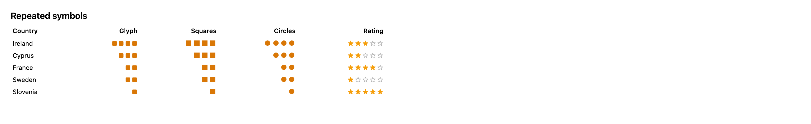

Two references are useful throughout: `@column` marks a column name wherever an
option names a column (`sort_by="@x"`, `scale="@color"`, `footnote="@note"`,
`link="@url"`, `color="@bar_colour"`, …), and colours accept matplotlib names
(`"tab:blue"`, `"C3"`, `"k"`).

### Composing marks in a column

A column is a *presentation slot*: it can hold an ordered list of **marks**
(encodings), each bound to its own field and sharing one horizontal scale. The
mark constructors — `col.bar`, `col.point`, `col.range`, `col.stacked_bar`,
`col.strip` — return a chainable column; `.bar(...)`/`.point(...)`/`.range(...)`
append a mark and `.label(...)` annotates the most recent one.

```python
columns=[
    # two overlaid bars, this year over last (size is the height fraction)
    col.bar("current", color="navy", size=0.8)
       .bar("previous", color="#d1d5db", size=0.2),
    # a bar whose label is another field, coloured per row
    col.bar("votes", label="@candidate", color="@party_colour"),
    # a value with an independent target marker
    col.bar("current").point("target"),
    # a point plus its interval, on a fixed 0–100% scale
    col.range("low", "high", cap="line").point("estimate").scale(domain=(0, 100), unit="%"),
    # a column-wide benchmark rule
    col.bar("debt").reference_line(55, label="Developing average"),
    # a five-part stack, labelled, normalised to percentages
    col.stacked_bar("ally", "friendly", "unknown", "unfriendly", "hostile",
                    colors=["#9333ea", "#c084fc", "#ddd", "#fb8b80", "#ef4444"],
                    labels=True, normalize="percent"),
    # an ordered categorical sequence (form / states)
    col.strip("form", colors={"W": "green", "D": "grey", "L": "red"}, labels=True),
    # a precomputed five-number summary with outliers
    col.boxplot("minimum", "q1", "median", "q3", "maximum", outliers="outliers", whisker="iqr"),
]
```

- **Marks** — `bar(source, color=, color_negative=, size=, side=, valign=, ...)`,
  `point(source, size=, color=)`, `points(source, size=, color=)` (one marker per
  array element), `range(low, high, cap="none"|"line"|"dot"|"arrow", fill=)`.
  `fill=True` draws the interval as a translucent band instead of a line.
  `side="left"`
  `|"right"` draws a nonnegative magnitude from the central origin; `size` is the
  bar height fraction or the point/range marker size; `valign="top"|"center"|
  "bottom"` places the mark vertically (top/bottom with small sizes gives
  side-by-side bars). `cap="arrow"` marks an endpoint that extends beyond the
  displayed scale.
- **Stacks** — `stacked_bar(*sources, colors=, labels=, label_align="begin"|
  "center"|"end", normalize="percent", size=, diverge_at=, neutral="split")`.
  `labels=True` writes each segment's value and `labels="percent"` its share;
  `size` is the stack height fraction. `diverge_at="neutral", neutral="split"`
  centres the named segment on the origin and grows the categories either side
  left and right (a Likert chart).
- **Boxplot** — `boxplot(minimum, q1, median, q3, maximum, outliers=, whisker=`
  `"extrema"|"iqr")`. The renderer never computes statistics; the five numbers
  arrive from SQL or Python.
- **Distribution** — `distribution(source, x="position", y="density",
  style="band")` draws a density band from a precomputed `LIST<STRUCT<x, y>>`
  (ordered positions, not raw samples). Combine with `.point("median")`.
- **Strip input** — a list of categories (`LIST<category>`) is equal-width; a
  list of `{start, end, category}` structs is positioned on a shared x axis, and
  a list of `{position, category}` structs fills each state to the next.
- **Labels** — `label=True` labels the mark's own value, `label="@field"` labels
  another field, `label={source=, text=, prefix=, suffix=, format=, position=,
  align=, overflow=, min_width=, color=}` is the mapping form, and `.label(...)`
  the long form. Repeated `.label(...)` calls refine the latest mark's label,
  retaining its source unless a new source/text/value is supplied. `align`
  (`"begin"|"center"|"end"`) places text inside a bar or stack segment. Where a
  label position is omitted, bars label `outside_end` and points `center`.
  Labels that do not fit hide completely by default, with the original values
  retained in the mark tooltip and accessible text; `overflow="show"` opts out.
  `min_width` is a pixel threshold. `.range(..., cap="line", overflow="arrow")`
  keeps endpoint caps and independently indicates out-of-domain intervals.
  Text inside bars and stack segments defaults to white on dark fills and dark
  text on light fills. An explicit label `color` overrides this choice.
- **Scale** — `.scale(domain=(lo, hi), include_zero=, unit=, transform=`
  `"linear"|"log", axis=, axis_position="top"|"bottom", gridlines=)` fixes the
  shared quantitative axis; `.reference_line(value, label=, color=)` adds a rule
  and `.reference_band(low, high, label=, color=)` shades a zone (a target or
  equivalence range). `axis=True` draws tick labels for the column, and
  `gridlines=True` faint vertical lines through the cells. A log scale needs a
  positive domain, uses a power-of-ten tick ladder, and is what a forest plot
  uses with `.reference_line(1)`.
  Repeated `.scale(...)` calls preserve earlier settings; `domain="auto"`
  explicitly clears fixed bounds. Missing data suppresses only its own mark.
  Automatic marks domains exclude synthetic rows and include all detail-row
  sources, interval endpoints and cumulative stack totals.
  For two-sided bars/Likert stacks, `(0, magnitude)` denotes the extent of
  each arm and displays a signed `-magnitude…+magnitude` axis. An explicit
  symmetric signed domain is also accepted; asymmetric signed bounds are rejected.
- **Cell chrome** — `.cell_style(background=, color=, border=, padding=)` styles
  the cell independently of the marks; `background="@column"` takes a per-row
  colour. Matching `rules` still win for the same property.
- **Sources** — a field name, `"@field"`, or a `lambda row: ...`. A callable is
  evaluated Python-side into a hidden helper column, so the browser (and any
  static export) only ever sees field names.

A single plain bar still serialises to the classic `viz="bar"` shape, so
`col.bar("revenue")` keeps working exactly as before.

Builder `.section(values=...)` rows display their summary values beside the
section label. `section_indent=1` insets detail stubs below left-aligned sections
by one rem. Builder summaries paginate; later pages repeat the section label.
Prepare filtered input before `rows.of(...).build()` to recalculate aggregates:
browser search preserves precomputed summary values, including Python callables.

`col.html(...)` and `.html()` explicitly opt into **trusted, unsanitized HTML**.
Only use them with content you control or have sanitized upstream. Ordinary text
columns escape source strings and never interpret them as HTML.

### Back-to-back bars

`direction="left"` mirrors the bar, so a leftward column and a rightward one
either side of a label column make a back-to-back ("tornado") league table.
`reference=N` draws a benchmark rule on the bar's own scale (mirrored with a
leftward bar), `reference_label` captions it once on the last row, and
`color="@column"` keys both panels with one colour column:

```python
columns=[
    col.currency("spend", decimals=1).bar(
        direction="left", reference=4.3, reference_label="OECD median 4.3",
        color="@color", pad=3,
    ).align("left"),
    col.text("country"),
    col.number("rate", fmt="num2").bar(
        reference=0.32, reference_label="OECD median 0.32", color="@color", pad=3,
    ).align("right"),
    col.auto("color").hide(),
]
```

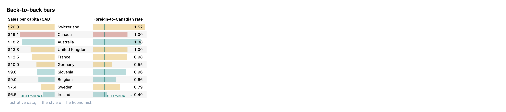

## Formatting

The kind factories cover the common cases; `.fmt()` is the escape hatch when you
need an exact SSF code.

```python
columns=[
    col.text("item", title="Item"),
    col.integer("count", title="Count"),
    col.currency("price", title="Price"),
    col.percent("share", decimals=0, title="Share"),
    col.date("day", title="Day"),
    col.flag("origin", title="Origin"),
    col.boolean("active", title="Active"),
]
```

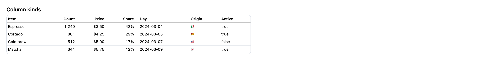

Dates and times can print as **relative** time (`"2 hours ago"`) with
`relative=` on the factory or the `.relative()` chain method; the unit can be
`"auto"` or an explicit one:

```python
col.datetime("at", relative=True)
```

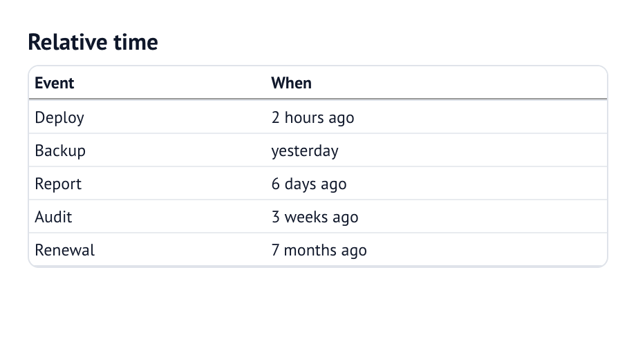

Body-cell styling — negatives, weight, italics, highlights — is also part of the
chain:

```python
columns=[
    col.text("metric", title="Metric").bold(),
    col.currency("q1", decimals=0, title="Q1").neg(),
    col.currency("q2", decimals=0, title="Q2").neg(bracket=True),
    col.percent("change", decimals=1, title="Change").neg().italic(),
    col.percent("change", decimals=1, title="Δ %").bold().highlight("#fef3c7"),
]
```

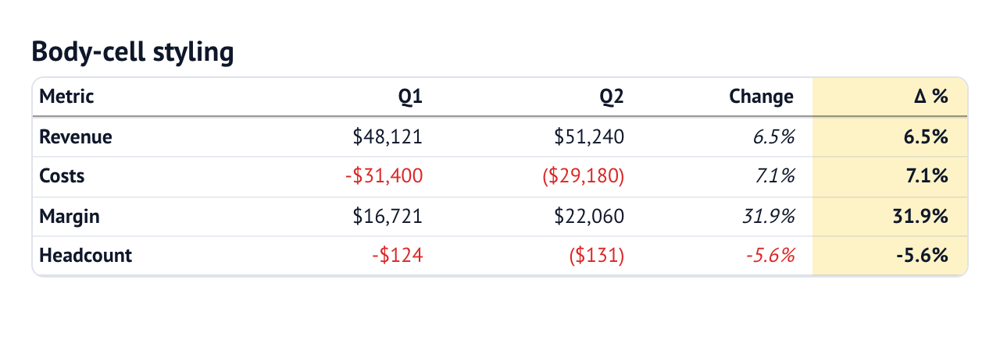

`.neg()` marks negative numbers (red by default; pass `color=`) and
`bracket=True` switches to accounting brackets (`-$1,234` → `($1,234)`) so the
column stays right-aligned. `font_size` on the table scales all content without
scaling the controls.

## Display rules

gt-style rules transform values at render time, leaving the data untouched. Each
is a `locations` dict from `cells_body(...)` plus an effect:

```python
from evidential import cells_body, tab_style, text_transform

rules=[
    text_transform(cells_body("category"), str.upper),
    tab_style(cells_body("sales"), color="#b45309"),
]
```

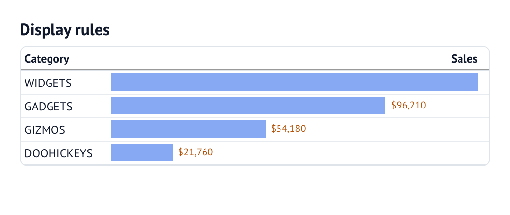

`tab_style` applies CSS to a location; `tab_format` overrides the format code
there; `text_transform` rewrites the displayed value with a Python callable; and
`sub_missing` / `sub_zero` / `sub_small_vals` / `sub_large_vals` / `sub_values`
substitute placeholder text. They run in order and can target columns, rows, or
a predicate.

## Reference

### Column factories (`col.*`)

These are the only names `col.` exposes — the chain entry points. Factories
other than `auto`, `merge`, `group` and `subcolumns` return a `Column`;
`group`/`subcolumns` return a `ColumnGroup`.

| Factory | Notes |
| --- | --- |
| `col.text(name, *, title=)` | free text |
| `col.number(name, *, fmt=, align=, title=)` | auto-scaling number |
| `col.integer(name, *, fmt=, title=)` | `num0` |
| `col.percent(name, *, whole=False, decimals=, fmt=, title=)` | `pct…`; `whole=True` → `0.0"%"` |
| `col.currency(name, *, code="usd", decimals=, fmt=, title=)` | `usd, eur, gbp, aud, cad, cny, jpy, inr, krw, ngn, sek` |
| `col.boolean(name, *, title=, true_text=, false_text=, true_symbol=, false_symbol=)` | true/false |
| `col.date(name, *, fmt=, relative=, align=, title=)` | `type="date"` |
| `col.time(name, *, fmt=, relative=, align=, title=)` | `hms` |
| `col.datetime(name, *, fmt=, relative=, align=, title=)` | `yyyy-mm-dd HH:MM:SS` |
| `col.flag(name, *, title=)` | alpha-3 country codes |
| `col.icons(name, *, map={...}, title=)` | category → glyph / image |
| `col.bar(source, *, title=, label=, size=, side=, color=, …)` | bar (single = classic, chained = marks) |
| `col.point(source, *, title=, size=, color=, label=)` | point marker |
| `col.points(source, *, size=, color=)` | one marker per array observation |
| `col.range(low, high, *, cap=, fill=, color=, label=)` | interval / dumbbell |
| `col.stacked_bar(*sources, *, colors=, labels=, normalize="percent", diverge_at=, neutral="split")` | cumulative stack |
| `col.strip(source, *, colors=, labels=, segmented=)` | ordered categorical strip |
| `col.boxplot(minimum, q1, median, q3, maximum, *, outliers=, whisker="extrema")` | box plot |
| `col.distribution(source, *, x="position", y="density", style="band")` | density band |
| `col.shapes(name, *, shape=, color=, …)` | alias for `symbols` |
| `col.color(name, *, title=, **options)` | colour scale |
| `col.chip(name, *, min_width=, conditional_colors=, scale=, min=, max=, midpoint=, **extra)` | pill |
| `col.delta(name, *, down_is_good=, neutral_range=, chip=)` | change indicator |
| `col.sparkline(name, *, type="line"\|"area"\|"bar"\|"points", x=, y=, color=, fit_to_data=, y_fmt=, width=, height=, markers=, marker_color=, signed=, title=)` | trend |
| `col.symbols(name, *, symbol=, shape=, empty=, max=, image=, color=, empty_color=, size=, gap=, align=, title=)` | repeated symbols |
| `col.rating(name, *, max=5, symbol="★", empty="☆", color="#f59e0b")` | star rating |
| `col.repeat(name, **options)` | alias for `symbols` |
| `col.link(name, *, label=, new_tab=, title=)` / `col.url` | hyperlink |
| `col.image(name, *, height=, width=, alt=)` / `col.logo(name, *, height=)` | image |
| `col.markdown(name, *, title=)` / `col.html(name, *, title=)` | rich text |
| `col.auto(name, **overrides)` | keep the inferred definition, then refine |
| `col.merge(name, spec)` | name a `cols_merge_*` result |
| `col.array(name, *, title=)` | a list-valued column (sparkline input) |
| `col.group(label, columns, *, highlight=)` | spanner header (`ColumnGroup`) |
| `col.subcolumns(label, columns, *, group=, highlight=)` | shared leaf header (`ColumnGroup`) |

### `Column` chain methods

| Method | Summary |
| --- | --- |
| `.title(str)` | header text |
| `.fmt(code)` / `.format(code)` | SSF format code |
| `.total_fmt(code)` / `.subtotal_fmt(code)` | aggregate-row format |
| `.align("left"\|"right"\|"center")` | alignment |
| `.align_decimals(bool=True)` | pad decimals |
| `.figure_style("lining"\|"oldstyle"\|"tabular"\|"proportional")` | numerals |
| `.font(family)` / `.font_color(color)` | body font |
| `.bold(bool=True)` / `.italic(bool=True)` | weight / slant |
| `.font_weight(str)` / `.font_style(str)` | escape hatches |
| `.wrap(bool=True)` / `.rotate_title(deg)` | layout |
| `.null_text(str)` / `.blank(pred)` / `.blank_below(v)` / `.blank_above(v)` | suppress values |
| `.neg(color=, bracket=False)` / `.red_negatives(bool=True)` | negatives |
| `.highlight(color)` | tint the column |
| `.cell_style(background=, color=, border=, padding=)` | cell chrome (background may be `"@column"`) |
| `.group(label)` / `.subcolumn(label)` | header structure (dict spelling) |
| `.repeat_values(bool=True)` / `.hide(bool=True)` / `.sort_by(column)` | display |
| `.info(str)` / `.footnote(column)` | tooltip / footnote |
| `.markdown()` / `.html()` | render rich text |
| `.link(column=, *, label=, new_tab=)` / `.image(...)` / `.logo(...)` | rich cells |
| `.template(value, **formats)` | fill-in-the-blanks cell |
| `.viz(kind, **options)` | set `viz` directly |
| `.bar(...)` / `.color(...)` / `.chip(...)` / `.delta(...)` / `.sparkline(...)` / `.symbols(...)` | visualisations |
| `.bar(source, …)` / `.point(source, …)` / `.range(low, high, …)` | append a mark |
| `.label(value=True \| "@field", *, source=, text=, position=, format=)` | annotate the last mark |
| `.scale(domain=(lo, hi), include_zero=, unit=, transform="linear"\|"log", axis=, axis_position=, gridlines=)` / `.reference_line(value, label=, color=)` / `.reference_band(low, high, …)` | shared axis / rules |
| `.relative(value=True)` / `.fmt_column(column)` | relative time / format source |
| `.to_config()` | the plain dict |

### Table options

`title`, `subtitle`, `caption`, `null_text`, `stub`, `stub_head`,
`footnote_marks`, `all_caps`, `stretch`, `align_decimals`, `group_gap`,
`rotate_titles`, `figure_style`, `font_size`, `footnote_column`, `footnotes`,
`info`, `info_link`, `info_link_title`, `search`, `page_size`, `sortable`,
`download`, `row_shading`, `row_lines`, `border`, `freeze_columns`, `wrap`,
`wrap_titles`, `format_titles`, `show_total_row`, `total_label`,
`total_position`, `subtotal_position`, `collapsible`, `collapsed`, `groups_open`,
`group_type`, `link`, `width`, `max_height`, `order_columns_by_group`,
`row_numbers`, `column_stats`, `compact`, `empty_message`, `empty_rows`,
`default_sort`, `row_conditional_colors`, `show_link_column`, `select`,
`header_color`, `header_font_color`, `total_row_color`, `total_font_color`,
`background_color`, `theme`, `color_scale`.

### Module functions

Data sources and constructors: `EvidentialTable`, `LiveEvidentialTable`,
`grouped_table`, `grouped_records`, `pivot_table`, `comparison_table`,
`query_table`, `simple_table`. Aggregation: `BUILTIN_AGGREGATIONS`,
`resolve_aggregation`, `apply_aggregations`. Rules: `cells_body`, `tab_style`,
`tab_format`, `text_transform`, `sub_missing`, `sub_zero`, `sub_small_vals`,
`sub_large_vals`, `sub_values`, `cols_merge`, `cols_merge_range`,
`cols_merge_uncert`, `cols_merge_n_pct`, `resolve_rules`. Helpers: `settings`,
`date_range_sql`, `make_column`, `query_values`, `section_row`, `spacer_row`,
`rows`, `Rows`,
`duck`,
`Column`, `ColumnGroup`, `CURRENCY_CODES`, `col`.

### See also

- [`docs/design-and-dx.md`](../design-and-dx.md) — the design principles.
- [`docs/technical-architecture.md`](../technical-architecture.md) — how it
  works.
- [`notebooks/`](../../notebooks) — runnable examples of every feature.
- [`docs/adr/`](../adr/README.md) — the decisions behind the API.
