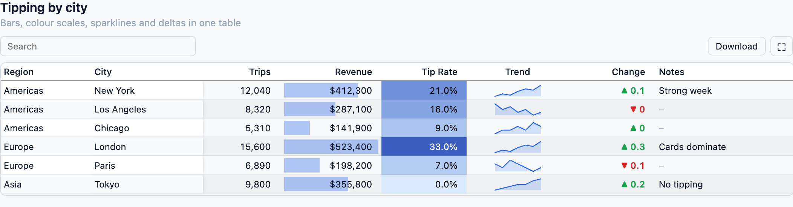
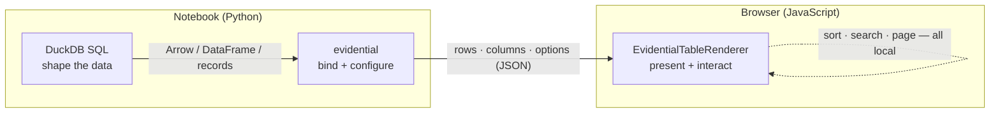
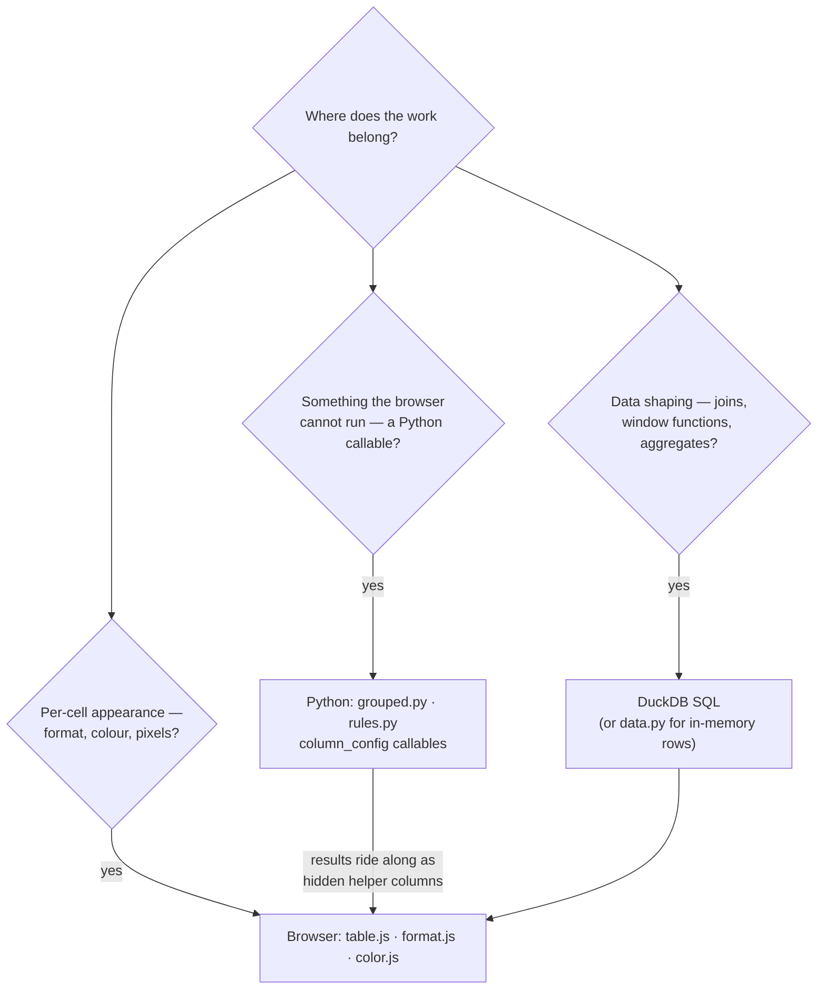
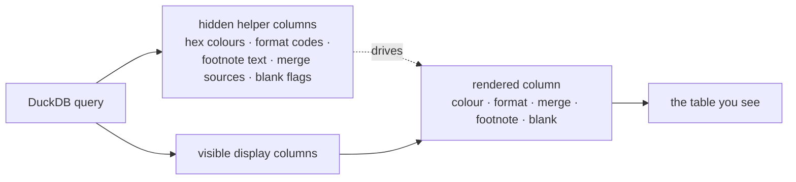
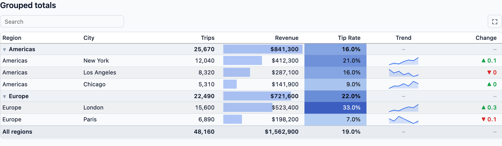
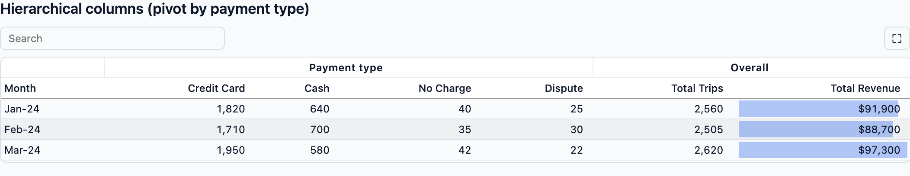
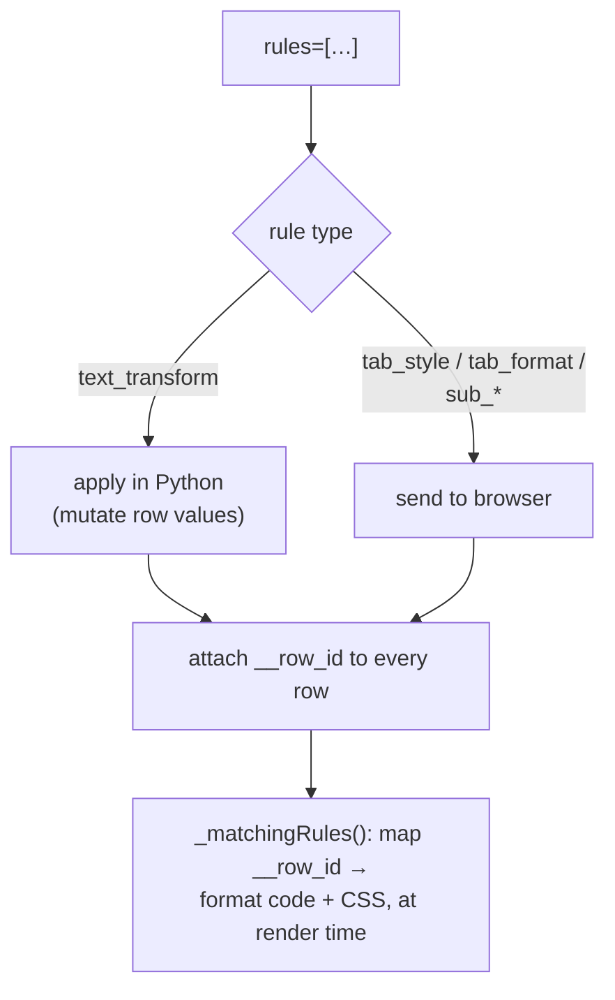
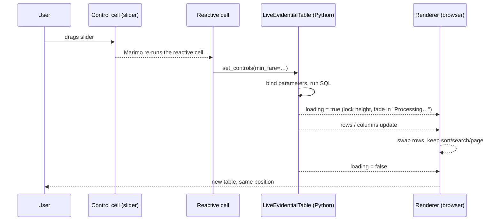
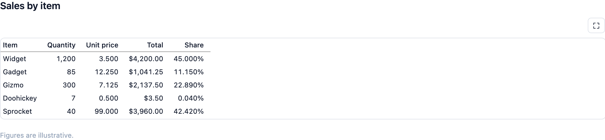

# design & DX

Why `evidential` works the way it does, from the point of view of the
person writing the notebook.

This is the *intent* document. For the mechanics, see
[technical-architecture.md](technical-architecture.md).

---

## 1. The problem

A dataframe plotted in a notebook is easy; a dataframe made **readable** is not.
Marimo, pandas and Arrow give you values, but a table that a human can actually
scan needs:

- formatting that matches the meaning of a column (`$412,300`, `21.0%`,
  `2024-01-01`, `12 KB`);
- visual cues — bars, heatmaps, sparklines, deltas — that turn numbers into
  shapes;
- grouping with subtotals, so "per region" is a structure and not a `groupby`
  you re-read;
- interaction — sort, search, paginate, freeze — that doesn't require a rewrite;
- typography that respects the reader: aligned digits, no shouting furniture.

Evidence.dev's `DataTable` is, in our opinion, the best-executed version of this
idea. It is a Svelte component wired to Evidence's own SQL query builder, which
makes it hard to lift into a Python notebook.

`evidential` is the focused reimplementation: **the presentation half of
Evidence's DataTable, exposed to Python, rendered in Marimo through
[anywidget](https://anywidget.dev).**



---

## 2. Who it is for, and the DX principles

The audience is the analyst in a notebook who knows SQL and pandas but does not
want to become a front-end engineer to ship a decent table.

Five principles fall out of that.

### 2.1 Python is the interface

Any behaviour we ship must be reachable from a Python call. There is no required
JavaScript, no build step for the user, and no separate config file. The built
bundle is committed into the wheel so `pip install` is the whole toolchain:

```python
from evidential import EvidentialTable

EvidentialTable(rows, title="Sales", page_size=15, search=True)
```

### 2.2 Data in, table out

You should be able to hand over whatever container you already have — a list of
dicts, a pandas `DataFrame`, a pyarrow `Table`, a DuckDB relation — and get a
table. Column types and default formatting are inferred; explicit config is an
*override*, never a prerequisite.

```python
EvidentialTable(con.sql("SELECT * FROM trips LIMIT 5000"))
```

### 2.3 Evidence-shaped names

Where Evidence has a name for a thing, we use it. `viz="bar"`,
`color_scale="green"`, `page_size`, `freeze_columns`, `group_type="section"`,
`contentType="sparkline"`. This buys two things: anyone who has used Evidence is
immediately productive, and the API has already been argued about by people who
built a great table.

### 2.4 Progressive disclosure

The simple call is simple. Depth is one dict away, and only for the columns that
need it. You do not describe the whole table to change one cell's format.

```python
EvidentialTable(
    rows,
    column_config={
        "revenue": {"fmt": "usd0", "viz": "bar"},
        "tip_rate": {"fmt": "pct1", "viz": "color", "color_scale": "green"},
    },
)
```

### 2.5 Presentation is separate from data

The widget is a **display** component. It does not own your query, your joins or
your business logic. It receives rows and a description of how to present them.
That keeps the renderer small, predictable and fast, and it means the same table
can be fed by DuckDB, pandas or a literal list without changing anything.



---

## 3. Where the ideas came from

Three projects shaped the design; a fourth shaped the integration.

| Influence | What it is | What we took |
| --- | --- | --- |
| **[Evidence.dev `DataTable`](https://legacy-docs.evidence.dev/components/data/data-table)** | A Svelte table bound to Evidence's SQL query builder. | The north star. Prop names and semantics (`viz`, `color_scale`, `content_type`, `fmt`, `page_size`, `freeze_columns`, `group_type`); `formatValue` on top of Excel format codes; `table-viz` range logic; `color-scale-utils`; collapsible grouped subtotals; `contentType` shorthands (`sparkline`/`sparkarea`/`sparkbar`); the bar's `calc(100% - 4px)` clearance; the 1–2px row-height bar. |
| **[R `gt`](https://gt.rstudio.com/articles/gt.html)** | The "grammar of tables" for R. | The idea of **table parts** — header, stub, spanners, body, footer/footnotes — and **location-based styling**: `cells_body()` + `tab_style()` / `tab_format()` / `text_transform()`. Nested spanners, section rows, markdown titles. |
| **[Python `great_tables`](https://posit-dev.github.io/great-tables/)** | `gt` for Python. | `cols_merge*` column merging, `sub_*` substitutions, special formatters (`bytes`, `duration`, `roman`, `flag`), footnote marks, `all_caps`, `from_column`-style indirection. |
| **[A List Apart: "Web Typography: Designing Tables to be Read, Not Looked At"](https://alistapart.com/article/web-typography-tables/)** (Richard Rutter) | A typographer's rules for tables. | Left-align text / right-align numbers, match headings to their data, tabular lining numerals, decimal alignment, don't stretch tables, minimise furniture, white space for grouping, rotated headings. |
| **[anywidget](https://anywidget.dev) / [galaga](https://github.com/edouardkleinhans/galaga)** | The anywidget protocol and a Three.js widget. | The `_esm`/`_css` + `render({model, el})` contract, and the fullscreen dialog pattern. |

The rest of this document is mostly the *consequences* of those borrowings, and
the decisions we had to make where the inspirations disagreed.

---

## 4. Decisions and their rationale

Each decision below is written as **what we chose**, **why**, and **what it
costs**. The costs are real; they are listed so they can be revisited rather
than rediscovered. Every decision also has a dated, immutable ADR in
[`docs/adr/`](adr/README.md); this section is the readable narrative around them.

### 4.1 Display-only, not a query builder

**Chose.** The widget renders a result set. Shaping — filters, joins, pivots,
date ranges, prior-period comparisons — is done in SQL (with Python helpers that
*build* the SQL).

**Why.** Evidence's table is inseparable from its query builder, which is tied
to its Svelte store and DuckDB-in-the-browser. Marimo already has cell
reactivity, and the analyst already has SQL and DuckDB. Re-implementing a query
builder in Python would duplicate both and add a second place for bugs. We also
want to accept rows that never touched a database.

**Cost.** We cannot offer Evidence's dimension/measure UI, or "change the
metric" dropdowns, without the user writing SQL. We mitigate this with helpers
(`grouped_table`, `pivot_table`, `query_table`, `comparison_table`,
`date_range_sql`) and with `LiveEvidentialTable` for parameterised re-querying.

**Exception.** Row *selection* is a value the browser sends back ([ADR-032](adr/032-row-selection.md)):
the table still only paints the rows it is given, but a click can put a key in a
variable that the notebook reacts to — the drill-down in
`notebooks/29_row_selection.py`.

### 4.2 Three layers, each doing what it is good at

Put simply: **SQL shapes, Python binds, the browser paints.**



This is the single most important rule in the project, so it gets its own
paragraph.

**The JSON boundary.** `rows` must be JSON-serialisable, because that is what
anywidget sends to the browser. A Python lambda, a `Decimal`, a numpy scalar or
a timezone-aware `datetime` cannot cross that boundary. So:

- values are normalised by `data.py` (`Decimal` → `float`, dates → ISO strings,
  `NaN` → `None`, numpy/pyarrow scalars → Python);
- anything requiring a **Python callable** is evaluated in Python *before*
  serialisation — `blank=lambda v: v < 0` nulls the value, `text_transform`
  rewrites it, custom aggregations compute subtotals; and
- the *result* of that computation is what the browser sees.

### 4.3 Hidden helper columns: presentation logic that lives at render time

The most useful pattern in the whole project is that **SQL (or Python) can
produce extra columns that are never shown but drive a shown column.** The
renderer is dumb; the data is smart.



Real examples from the codebase:

| Want | Helper column | Column option that consumes it |
| --- | --- | --- |
| Per-row cell tint, chosen by business logic | `tint` (a hex string) | `row_conditional_colors="tint"` |
| A different number format per row | `money_fmt` (`"usd0"`/`"pct1"`/…) | `fmt_column="money_fmt"` |
| `10–20`, `5 ± 0.2`, `120 (31.0%)` | `low`, `high`, `uncert`, `n`, `pct` | `cols_merge_range(...)` etc. |
| A footnote attached to specific cells | `intel_note` (text) | `footnote="intel_note"` |

```python
# The merged column is never in the data; it is synthesised from two hidden ones.
EvidentialTable(
    rows,  # rows carry "low" and "high"
    column_config={
        "price_range": cols_merge_range("low", "high", fmt="num0"),
    },
)
```

**Why.** It keeps the renderer a pure function of `(value, column_config)`. It
turns "presentation logic" into ordinary data manipulation, which the analyst is
already good at and which the database can push down. It also means a new
presentation idea usually needs no JavaScript at all.

**Cost.** The notebook has to know to build the helper column, and hidden
columns are invisible in the rendered table, so it can be a little magical the
first time. The README and the demo notebooks lean on this pattern explicitly to
make it discoverable.

### 4.4 Formatting is somebody else's hard problem

**Chose.** Cell values are formatted with Excel-style format codes via the
[`ssf`](https://github.com/SheetJS/ssf) package, exactly as Evidence does,
surrounded by our own convenience presets.

**Why.** "Format a number like a spreadsheet" is a solved problem with decades
of edge cases (negatives in parentheses, thousands separators, percent scaling,
byte units, date serials). Re-implementing it would be a source of subtle
divergence from Evidence. `ssf` gives us fidelity and a *language* users already
know: `"usd2"`, `"pct1"`, `"#,##0.0"`, `"mmm-yy"`.

On top of that we add:

- **presets** generated programmatically — `num0…num4`, `pct0…pct3`,
  currencies, `num0k`/`num1M`/…, dates (`mmm-yy`, `shortdate`, `quarter`);
- **auto-scaling base formats** (`num`, `usd`, `pct`, …). A three-character base
  format picks its decimals and unit (`k`, `M`, `B`) from the column's range, so
  a revenue column becomes `$1.2M` without the user choosing.

**Cost.** `ssf` is a JavaScript dependency, and format codes are less readable
than `f"{x:,.2f}"`. We mitigate with presets and by documenting the common ones.

### 4.5 Colour scales are ported, not invented

**Chose.** Colour interpolation, contrast-aware text colour and diverging scales
are ported from Evidence's `color-scale-utils` using
[`chroma-js`](https://gka.github.io/chroma.js/).

**Why.** A heatmap that is subtly wrong is worse than no heatmap. Matching
Evidence's LCH interpolation, midpoint handling and light/dark text decision
means the same `color_scale` produces the same result in both systems. Named
presets (`green`, `blue`, `red`, `orange`, `purple`, `grey`) are provided so a
heatmap is one word.

### 4.6 Grouping is one SQL query plus a decoration pass

**Chose.** `grouped_table` issues a single DuckDB `GROUPING SETS` query, then
decorates the rows in Python with the metadata the renderer needs
(`render_type`, `__level`, `__group_key`, `__ancestors`).

**Why.** Subtotals and a grand total are exactly what `GROUPING SETS` computes,
and doing it in the database keeps the row set small and the SQL honest. The
Python pass is metadata-only (no re-aggregation unless the user asks), which
keeps it fast and easy to test. `grouped_records` reuses the same decoration for
in-memory data, so the renderer has exactly one grouping model.

**Cost.** `grouped_table` owns the SQL generation, so unusual queries may need
`query_table` plus manual metadata. The escape hatch exists.



Hierarchical columns are the same idea applied horizontally: `column_groups`
(or `pivot_table`) puts several columns under one spanner, and the renderer
clusters each group at its first occurrence, so a leading dimension column keeps
its place. A **dotted column name** is a shortcut for the same grouping — the
part before the last dot becomes the group and extra dots nest — so a query can
carry its own header structure without a separate mapping
([ADR-028](adr/028-dotted-column-name-groups.md)).



### 4.7 Rules borrow gt's location API

**Chose.** `tab_style` / `tab_format` / `text_transform`, each taking
`cells_body(columns, rows)`, and applying in order with last-match-wins.

```python
rules=[
    tab_style(cells_body(columns=["sales"], rows=lambda r: r["sales"] < r["prior"]),
              background="#fee2e2", color="#b91c1c"),
    tab_format(cells_body(columns=["revenue"]), "usd0"),
    text_transform(cells_body(columns="code"), str.upper),
]
```

**Why.** Per-column config cannot express "this one cell is an outlier". gt's
`locations` idea composes cleanly and is already familiar. Rules are the one
place where a Python *callable* is natural (`rows=lambda r: ...`), and it is
resolved in Python.

**Implementation consequence.** Because sorting and paging happen in the
browser, a rule cannot refer to "row 7 of the sorted table". We resolve row
predicates in Python and attach a stable `__row_id` to each row; style/format
rules travel to the browser as `{columns, rows: [__row_id...], style|fmt}`,
while `text_transform` is applied in Python before serialisation.



### 4.8 Live tables work *with* Marimo's reactivity, not against it

**Chose.** `LiveEvidentialTable` keeps a parameterised query and re-runs it in
place. In Marimo the widget is created **once** in a cell that does not reference
any control; a second, reactive cell calls `set_controls(...)`.

**Why.** This is the single sharpest DX trap in the project. Marimo re-runs any
cell whose referenced values change. If the widget and its slider are created in
the same cell, every slider move recreates the widget — and the table visibly
disappears and reappears. Separating construction from control-binding preserves
sort, search and page state and keeps the table on screen.



Parameter values are bound as SQL parameters, never spliced into the SQL text,
so a live filter is not an injection hole.

### 4.9 Loading should not flicker

**Chose.** Live updates keep the table's size, and only fade to a
"Processing…" overlay if the query takes longer than ~180ms; otherwise the rows
simply swap in place.

**Why.** Dragging a slider fires many queries. Flashing an empty table on every
one is worse than showing stale data for 200ms. A stable layout is the whole
point: the user's eye stays on the same cell.

### 4.10 Typography is a feature

The A List Apart principles are cheap to honour and expensive to ignore, so they
are defaults, not an afterthought.

| ALA principle | How `evidential` expresses it |
| --- | --- |
| Left-align text, right-align numbers | alignment defaults by column `type` |
| Match headings to their data | header alignment follows the column's |
| Tabular, lining numerals | `lining-nums tabular-nums` by default; `figure_style` overrides |
| Align to the decimal point | `align_decimals=True` pads to a common precision |
| Don't stretch tables | `stretch=False` sizes columns to their content |
| Minimise furniture | `row_lines=False`, no frame, no fills |
| Consistent precision per column | auto-scaling formats agree within a column |
| White space for grouping | `group_gap`, `section_row`, group-size stripes |
| Rotated headings | `rotate_titles="vertical"` or oblique degrees |

One subtlety the article forces: **many fonts default to oldstyle (lowercase)
figures**, which read beautifully in prose and badly in columns. We therefore set
`font-variant-numeric: lining-nums tabular-nums` explicitly, and expose
`figure_style` (`"oldstyle"`, `"proportional"`, `"default"`, …) for tables where
the font's own figures are wanted.



### 4.11 The fullscreen view is a first-class mode

**Chose.** A ⛶ button moves the table into a modal dialog that fills the
viewport, recalculates how many rows fit, and restores the configured page size
on exit.

**Why.** Notebook cells are narrow; a wide table wants the browser window. The
dialog arithmetic (measure the header and a row, divide the available height)
means "fullscreen" shows *more data*, not just bigger data. Backdrop click,
Escape and the × all return the table to its inline position.


### 4.12 One notebook, many audiences (marimo Studio)

**Chose.** Present the table to marimo Studio by **projection**: a view places
the cell that displays the `EvidentialTable` (`<marimo-cell>`), native controls,
and individual values (`mo-value`). The notebook stays the single source of
truth; the view owns only presentation.

**Why.** Studio already defines a projection contract, so a separate widget or
provider would be redundant. Because the table is an interactive anywidget, the
view uses Studio's **Server** runtime; the notebook computes, the view lays out,
and every result still traces back to a cell. Studio views are delivered next
to the notebook in a committed `view_root`, and the demo is guarded by a
repository test that needs no Studio install.

See [using EvidentialTable in Studio views](marimo-studio.md) and
[ADR-021](adr/021-marimo-studio-projections.md).

---

## 5. A day in the life: three levels of use

**Level 0 — just show me the data.**

```python
EvidentialTable(con.sql("SELECT * FROM trips LIMIT 500"))
```

**Level 1 — make a few columns readable.**

```python
EvidentialTable(
    con.sql("SELECT * FROM trips LIMIT 500"),
    title="NYC yellow taxi trips",
    search=True,
    page_size=15,
    column_config={
        "trip_distance": {"fmt": "num1", "viz": "bar"},
        "fare_amount": {"fmt": "usd2"},
        "tip_rate": {"fmt": "pct1", "viz": "color", "color_scale": "green"},
    },
)
```

**Level 2 — shape it in SQL and present it richly.**

```python
grouped_table(
    con,
    "SELECT * FROM trips",
    dimensions=["payment", "is_weekend"],
    measures=["count(*) AS trips", "round(sum(total_amount), 0) AS revenue"],
    total_label="All trips",
    subtotal_position="top",
    collapsible=True,
    measure_config={"revenue": {"fmt": "usd0", "viz": "bar"}},
)
```

Each level is additive, and each stays in Python.

---

## 6. What we chose *not* to do (yet)

Honesty about scope is part of the DX. Known gaps, with the reason:

- **Column comparisons and comparison tooltips.** Prior-period *columns* exist
  (`comparison_table`), but the hover tooltip that explains a delta is deferred.
  It needs a rendering channel for comparison metadata we haven't designed.
- **Excel export.** CSV is easy and done; `.xlsx` pulls in a writer dependency.
- **Virtualised scrolling.** Pagination caps memory and render cost today
  (`page_size` is clamped at 200). A million-row scroll view is its own project.
- **A query builder.** Deliberately out of scope; see §4.1.
- **`opt_stylize` presets and styles beyond the body.** gt's named styles and
  non-body locations (stub, summary, footer) are on the list; the location model
  is in place to receive them.

The full, tick-boxed inventory lives in [`PLAN.md`](../PLAN.md).

---

## 7. References

- Evidence `DataTable` docs — <https://legacy-docs.evidence.dev/components/data/data-table>
- Evidence source (`formatValue`, `table-viz`, `table-styles`,
  `color-scale-utils`) — <https://github.com/evidence-dev/evidence>
- R `gt` — *Introduction to Creating gt Tables* — <https://gt.rstudio.com/articles/gt.html>
- Python `great_tables` — <https://posit-dev.github.io/great-tables/>
- Richard Rutter, *Web Typography: Designing Tables to be Read, Not Looked At*,
  A List Apart — <https://alistapart.com/article/web-typography-tables/>
- anywidget — <https://anywidget.dev>
- Marimo — <https://marimo.io>
- DuckDB — <https://duckdb.org>
- `ssf` (SheetJS) — <https://github.com/SheetJS/ssf>
- `chroma-js` — <https://gka.github.io/chroma.js/>

Both Evidence and this project are MIT licensed.
