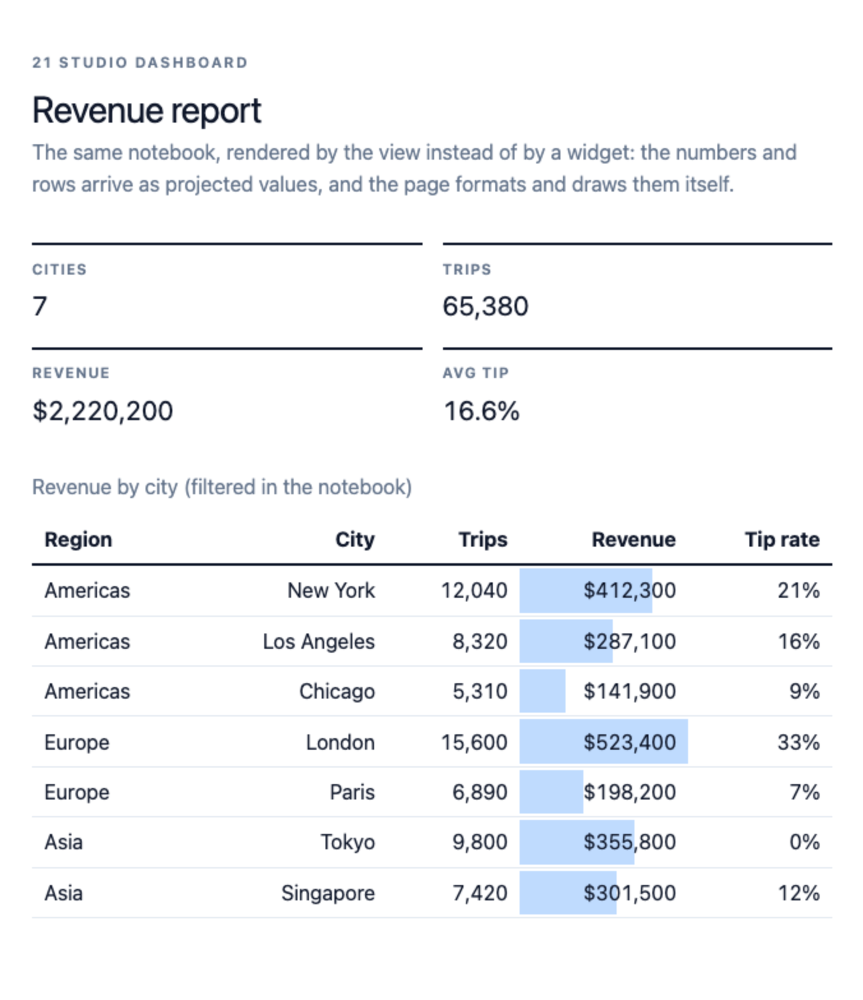

# EvidenceTable in marimo Studio views

[marimo Studio](https://marimo.io/blog/introducing-marimo-studio) turns one
reactive notebook into named **views**: a dashboard, article, slide deck or
PDF, each its own frontend project. A view places the notebook's cells, outputs
and **values** by name, so a live `EvidenceTable` and the numbers around it stay
in sync with the notebook.


## The short version

An `EvidenceTable` is a widget, so a Studio view shows it by projecting the
**cell** that displays it. Native controls and plain values are projected
separately:

```html
<!-- a live, interactive EvidenceTable -->
<marimo-cell name="revenue_table"></marimo-cell>

<!-- a native marimo control (dropdown, slider, …) -->
<marimo-cell name="region_filter"></marimo-cell>

<!-- one value, as data for the view's own code -->
<strong id="kpi-revenue" mo-value="kpis.revenue"></strong>
```

Because the widget is interactive, the view uses Studio's **Server** runtime.
The notebook owns the values; the view owns their presentation.

## The demo

| | |
| --- | --- |
| Notebook | [`notebooks/21_studio_dashboard.py`](../notebooks/21_studio_dashboard.py) |
| Views | [`…/dashboard/`](../notebooks/studio/21_studio_dashboard/dashboard/) and [`…/report/`](../notebooks/studio/21_studio_dashboard/report/) |
| Provider | `marimo-studio/vanilla` (a single `index.html` each) |
| Runtime | `server` |

Run it:

```console
make studio-serve        # opens the notebook with Studio installed
# or directly:
uv run --with "marimo-studio[deno]" marimo edit notebooks/21_studio_dashboard.py
# or, isolated from the project environment:
uv run --with "marimo-studio[deno]" marimo edit notebooks/21_studio_dashboard.py --sandbox
```

The views live next to the notebook in a committed `view_root`
(`notebooks/studio/21_studio_dashboard/`), configured in the notebook's own
module block:

```toml
# [tool.marimo-studio]
# default = "dashboard"
# view_root = "studio/21_studio_dashboard"
# runtime = "server"
```

### Two complementary views, one notebook

The demo ships both ways of using notebook results in a view, so you can see the
trade-off:

| View | Pattern | Shows |
| --- | --- | --- |
| **dashboard** | `<marimo-cell name="revenue_table">` | The notebook's own live, interactive `EvidenceTable` (Server runtime). |
| **report** | `mo-value="filtered"` | The raw rows, drawn by the view's own markup and JS — portable to a static export. |



The dashboard reuses the widget; the report reimplements a little presentation in
exchange for runtime portability. Both read the same notebook.

## Projection recipes

Studio gives a view three ways to reach into the notebook. Which one to use
depends on whether you want the notebook's own presentation or just its data.

| Goal | Element | Example |
| --- | --- | --- |
| Show a cell's output, live (a table, a chart, a control) | `<marimo-cell name="…">` | `<marimo-cell name="revenue_table">` |
| Show one object, even one the notebook never displays | `<marimo-output name="…">` | `<marimo-output name="summary_dict">` |
| Read one value into the view's own markup or JS | `mo-value="…"` | `mo-value="kpis.revenue"` |

### Reuse the notebook's own table

This is the recommended path: the notebook builds the `EvidenceTable` it wants,
and the view places it.

```python
@app.cell
def revenue_table(EvidenceTable, filtered):
    EvidenceTable(filtered, title="Revenue by city",
                  column_config={"revenue": {"fmt": "usd0", "viz": "bar"}})
```

```html
<marimo-cell name="revenue_table"></marimo-cell>
```

Interaction (sort, search, pagination, colour, bars, fullscreen) keeps working,
and changing a control in the view re-runs the notebook's dependent cells, so
the table updates in place.

### Read values into your own layout

`mo-value` projects a single value — a scalar, list, dict or eager dataframe —
as data. Use it when the view wants to draw the result itself:

```html
<span id="revenue" mo-value="kpis.revenue"></span>
```

```js
observeMarimoValue(document.getElementById("revenue"), {
  onValue: (value) => {
    document.getElementById("revenue").textContent =
      new Intl.NumberFormat("en-US", { style: "currency", currency: "USD" }).format(value);
  },
});
```

Eager dataframes arrive as a shared [Flechette
`Table`](https://github.com/uwdata/flechette) (columnar, with `getChild`,
`select`, `toArray`); keep the `mo-value` host in the authored HTML so Studio
can inspect and authorise the selector.

### Drive the notebook from the view

Views change notebook state through **native marimo controls**, not through
custom JavaScript. Project the control's cell, and keep the resulting state in
the notebook:

```html
<marimo-cell name="region_filter"></marimo-cell>
```

This is exactly how the demo's Region dropdown updates both the KPI strip and
the table.

## Choosing a runtime

Studio runs a view in one of three runtimes. The right choice for a table with
interactive widgets is **Server**.

| Runtime | Runs Python | Live `EvidenceTable` | Use when |
| --- | --- | --- | --- |
| **Server** | In the notebook's kernel | ✅ yes | The view needs the interactive widget (the normal case). |
| **Browser** (`wasm`) | In each visitor's browser (Pyodide) | ✅ yes, once `evidence-tables` is installable from PyPI | You want a static host (GitHub Pages) with no server. |
| **Prepared** (`zero-python`) | At export time | ❌ not replayable | A read-only report of captured values and figures. |

The demo pins `runtime = "server"` because `evidence-tables` is not yet on
PyPI; a Browser export would have no way to install it. Once it is published,
`runtimes = ["server", "wasm"]` makes the same view exportable as static files.

## Notes and caveats

- **Sandbox runs need the local package.** `evidence-tables` is not on PyPI
  yet, so the notebook's PEP 723 block points the dependency at the checkout
  with `[tool.uv.sources]`:

  ```toml
  # [tool.uv.sources]
  # evidence-tables = { path = "..", editable = true }
  ```

  Without it, `--sandbox` fails to resolve `evidence-tables`. Remove the
  override once the package is published.
- **Widget CSS is the widget's own.** The view supplies page chrome; the table
  injects its own stylesheet. Keep the view's selectors scoped so they do not
  collide with `.et-*`.
- **Respect the projection budgets.** A projected JSON value must encode within
  1,000,000 bytes, and a projected dataframe within 64 MiB of Arrow IPC. This is
  the same advice as the rest of the library: aggregate or filter in the
  notebook and project the small result, or split a large table into per-item
  frames selected at runtime.
- **One cell, one widget.** A projection targets a cell's output, so put each
  `EvidenceTable` in its own named cell. (A `mo.vstack([a, b])` cell projects as
  one output if you want them together.)
- **Name your cells.** Projections resolve cell function names (e.g.
  `revenue_table`) and variable names (e.g. `kpis`); anonymous cells only get
  positional `cell-N` aliases. Named targets survive edits.
- **Keep the view's `AGENTS.md`/`DESIGN.md` current** so the next agent (or
  person) knows the notebook targets and the runtime.

## Validate

```console
make studio-validate     # marimo-studio validate --target notebooks/21_studio_dashboard.py
```

`marimo-studio validate` checks that every projection site resolves against the
notebook's cells and values without running it. `tests/release/test_studio_views.py`
re-checks the committed view's manifest, provider and projection targets in CI,
without requiring Studio to be installed.

A **Prepared** or **Browser** export (`marimo-studio view export …`) needs
`evidence-tables` to be installable from PyPI, because Studio resolves the
notebook's declared dependencies in the export environment. Until the package is
published, export from a checkout where it is installed (the export bundles the
local build) or stick to the Server runtime.
