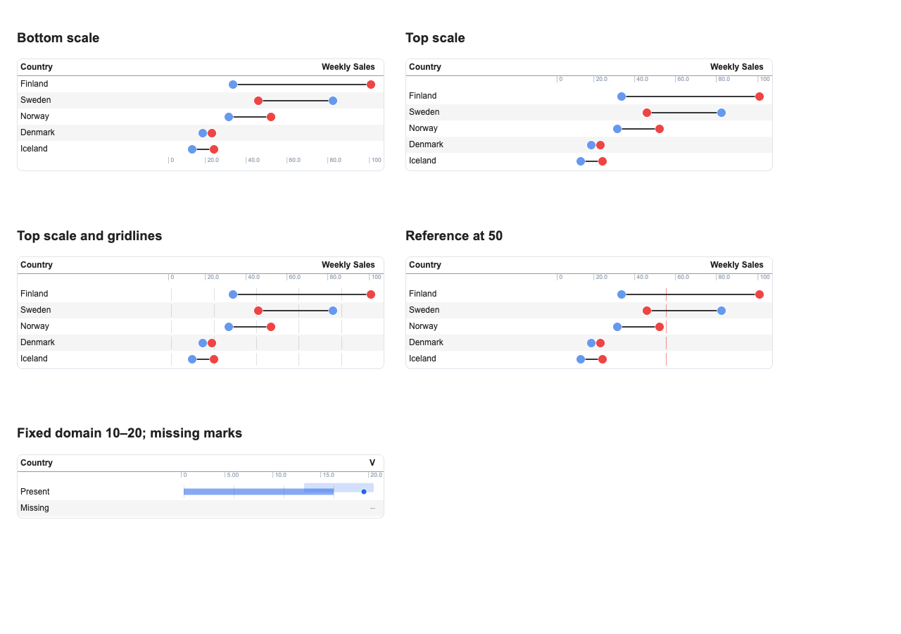
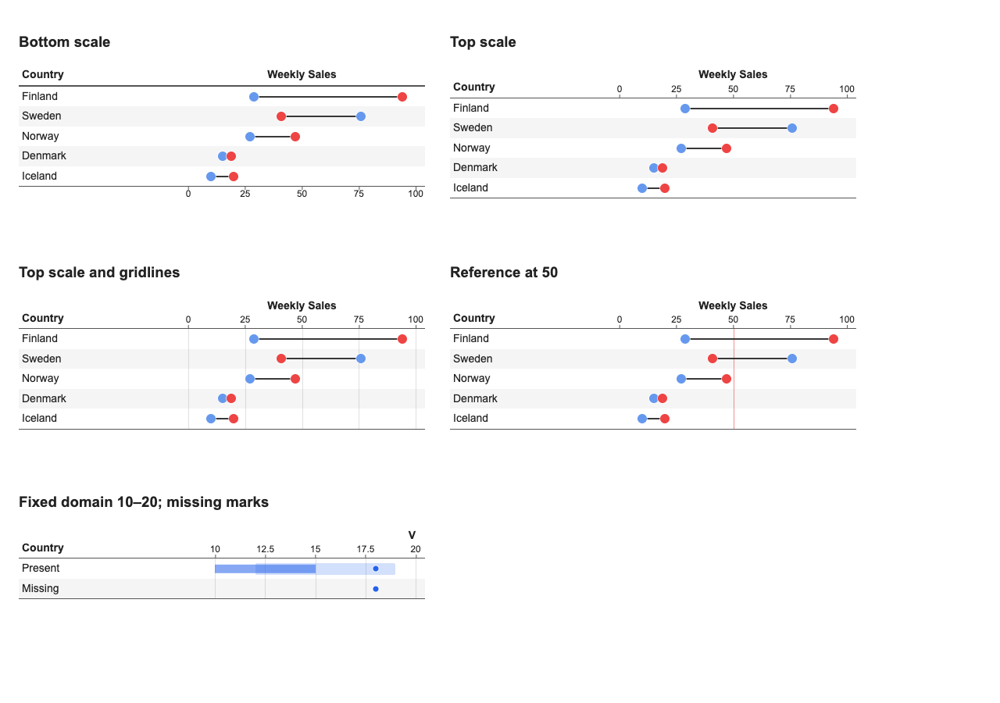
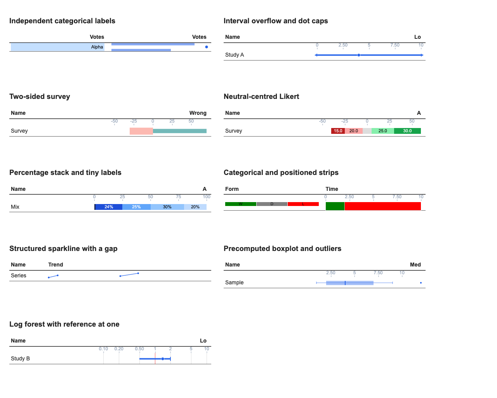
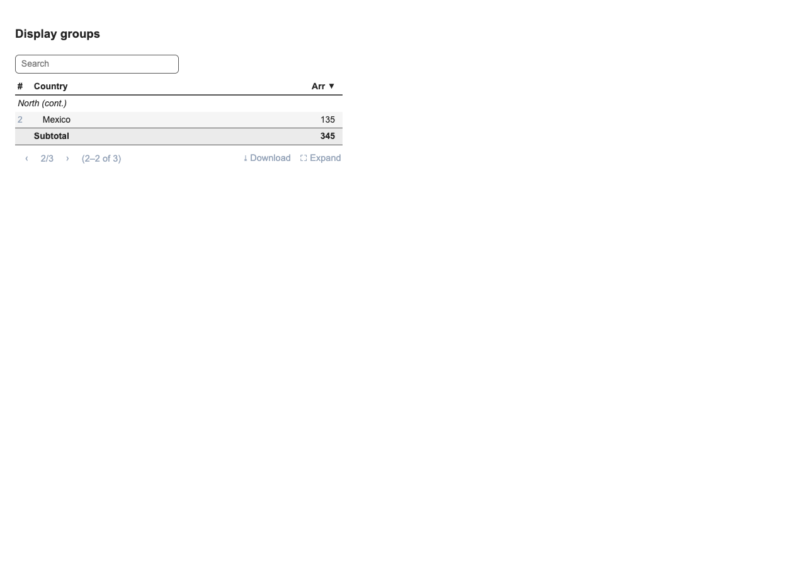
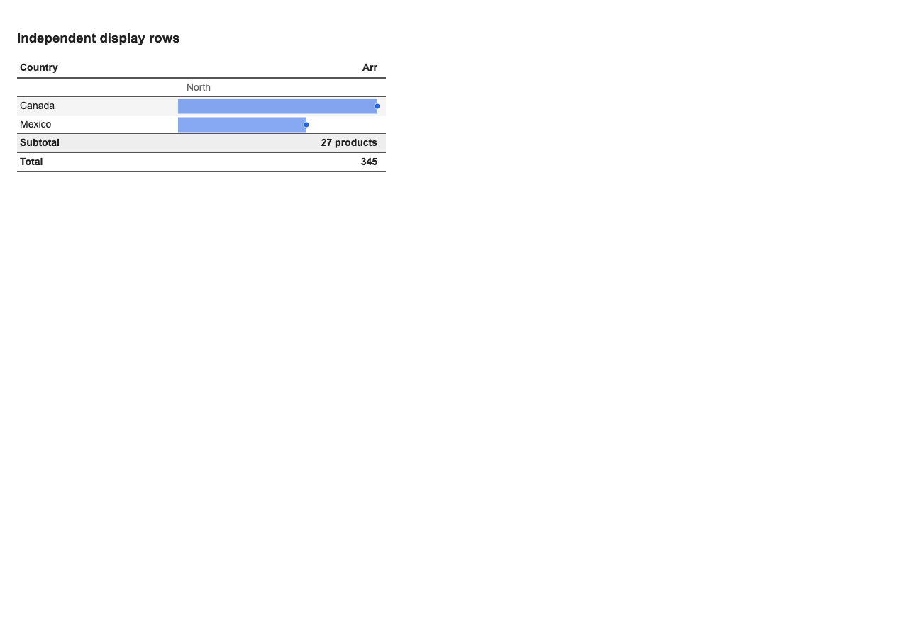
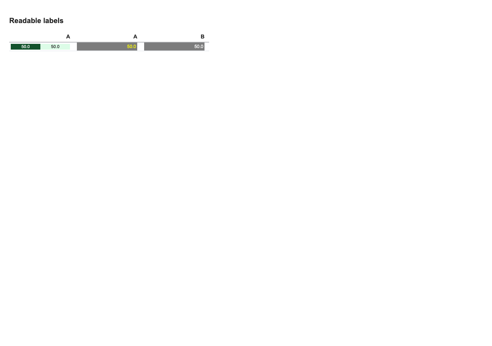
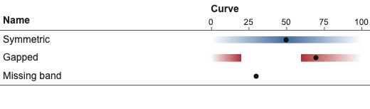
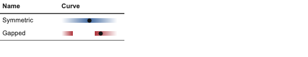

# API redesign branch: specification and design review

Reviewed on 2026-10-20 against the working copies of
`evidential_table_api_spec_v1.1.md` (design draft v2) and
`Marimo Report Design System.md`, including the supplied scale reference image.
The baseline is branch commit `9ef0701`; existing local notebook edits were
preserved. Requirements marked Adopt/Required were treated as contracts;
Propose/Open signatures and V2 ideas were distinguished from those contracts.

The branch had the main constructors, but several examples only worked for
complete data and convenient domains. Existing tests often checked that an
element existed without checking its coordinates, missingness or usable text.
The following defects were reproduced and corrected in this review.

## Confirmed defects and corrections

| Severity | Finding | Correction and coverage |
| --- | --- | --- |
| High | A null primary field hid valid sibling marks; other null fields/array elements became zero. | Mark-level missingness; null array observations are excluded from domains; missing strip slots remain empty. Frontend regressions and real Python-to-browser fixture. |
| High | Fixed domains were expanded to zero, and rendering duplicated domain logic. | One `marksDomain` implementation; fixed scalar bounds win. Python also rejects infinite/reversed bounds. |
| High | Diverging stacks normalized each row to its own longest arm, making equal values different widths. | Shared magnitude domain across rows; signed coordinates also align axes, points and references. |
| High | Stack targets counted as extra segments in domain inference; array/distribution columns ignored scalar overlays. | Per-encoding domain contributions in `mark-data.js`; targets contribute coordinates, stacks contribute cumulative totals. |
| High | Two presentation columns using the same source field overwrote each other's inferred domains. | Marks cache ranges by presentation object as well as the legacy field lookup; browser checks a stack beside a bar on the same field. |
| High | Structured sparklines discarded irregular x spacing and connected across missing observations. | Numeric/date x spacing, separate line/area runs around gaps, retained ordinal slots and conventional x/y bindings. DuckDB struct-list regression. |
| High | A section builder calculated summary values which the renderer discarded. | Combined section cells render their values; labels survive hidden grouping dimensions; centered sections reject values. |
| High | Sorting could move details between builder sections; search removed headings; summary rows disabled pagination. | Stable group metadata, section-preserving search/sort, paginated summaries and continuation headings. |
| Medium | Fluent label/scale refinements erased prior settings; bar refinement could emit an invalid label/color shape; vertical alignment could disappear through legacy serialization. | Immutable merges, normalized refinements, retained bindings/options and marks serialization for `valign`. Python regression tests. |
| Medium | Boxplots/distributions painted before earlier-declared scalar marks; point CSS also overrode paint order. | Declaration-order DOM and paint order, with references behind marks. |
| Medium | Axes used different horizontal padding from marks, including shared sub-columns; one column controlled all axis positions. | Matching padded tracks, sub-column decoration, independent top/bottom axes, readable ticks and 0/25/50/75/100 spacing. Browser geometry assertions. |
| Medium | Gridlines/reference rules broke between rows; `row_lines=False` removed the final boundary rule. | Continuous rules through adjacent data cells; per-page top/bottom boundaries retained. |
| Medium | Filled intervals shifted upward; dot caps looked like line caps; overflow arrows looked like squares and were unavailable independently of caps. | Correct band placement, round dot caps, triangular arrows and `overflow="arrow"`, including filled ranges. True endpoints remain accessible. |
| Medium | Tiny labels were clipped rather than hidden; centered/negative/above/below placements were incomplete. | Complete-label fit checks after render/resize, corrected placements, `overflow`, `min_width`, and explicit color options. |
| Medium | Label text stayed dark on dark fills. | Automatic white/dark text for bar and stack labels, including theme fills; explicit label colors win. Browser and unit coverage. |
| Medium | Invalid negative stack magnitudes, nonpositive log inputs, mismatched color lists and unterminated change-point strips silently produced misleading output. | Python validation with actionable errors before serialization. |
| Medium | Combined sections skipped alternating shading and there was no independent stub inset. | Combined rows consume a stripe slot; `section_indent` in rem applies beneath left-aligned builder sections. |

Domain inference, label rendering/fitting and sparkline rendering now live in
separate modules. The main renderer consumes the same shared domain used by
axes. The committed JS/CSS assets were rebuilt together with the sources.

## Browser evidence

These are actual Playwright screenshots of the shipped JS/CSS bundle, using
wire data produced by `EvidentialTable` and the public Python builders.

The baseline demonstrates an incorrect 0–20 axis for a fixed 10–20 domain,
the missing sibling point, disconnected reference/grid rules and absent final
boundary. Styling differs between baseline and final: the final fixture uses
14px text, no box border and darker rules to resemble the supplied reference.
Behavioral corrections are also checked numerically in the browser tests.

The broader gallery covers independent label bindings, layered bars, overflow,
two-sided survey bars, Likert stacks, small percent segments, categorical/time
strips, irregular sparklines, boxplots and a logarithmic forest plot.

## Acceptance and remaining scope

The specification's §16 scenarios are representable with the public builders.
The new browser fixtures exercise the marks gallery, both scale positions,
mixed positions, nested spanners/sub-columns with hidden sources, label fitting
and contrast, and combined/paginated sections with sorting and search. Existing
tests cover selection rules and the other table interactions. The new notebook
is [44_spec_conformance.py](../../notebooks/44_spec_conformance.py).

The 2026-10-21 follow-up replaces injected synthetic records with a separate
display layout ([ADR-064](../adr/064-display-only-row-layout.md)). Detail
callables no longer receive headings or summaries. Named summary expressions
and formatted counts now recalculate over browser search matches; pagination
counts details and repeats nested ancestor headings, with summaries on the
appropriate pages. Arbitrary Python callbacks and historical grouped-helper
summaries retain their source scope until a Python refresh. The examples in
[39_synthetic_rows.py](../../notebooks/39_synthetic_rows.py) and
[45_display_row_layout.py](../../notebooks/45_display_row_layout.py) demonstrate
the new contract.

That follow-up also isolates callable helper fields for repeated presentation
columns, restores unlabeled strip height and joined runs, and clips stacked
segments to fixed domains. Regression tests cover each defect, including real
browser geometry and annotation rule/style precedence.

The initial distribution implementation was incorrect: it drew a filled curve
instead of the reference's flat uncertainty band. It is replaced end to end by
[ADR-065](../adr/065-distribution-uncertainty-bands.md), with a distinct data and
intensity/height specification, validation, domain integration, projection,
painting, and dedicated tests. Notebook 37 now shows standard and compact bands.
Browser coverage samples actual painted pixels to verify darker peaks, pale
tails and transparent gaps, and checks confinement to the row and shared axes.

The axis follow-up corrects a separate layout error: scales are now outside the
data body, above its first horizontal line or below its last horizontal line,
with tick marks touching the lines. A top scale raises its column label while
unscaled labels remain beside the first body line. Statistics stay in the
header; frozen columns and fullscreen fitting account for both scale tiers.
Browser checks cover tick contact, label height at two font sizes, nested
sub-column alignment and pagination with header metadata.
Gridlines and reference lines now occupy a clipped layer bounded by each cell,
instead of extending past the glyph track. Browser regressions check that they
stay inside the row area without introducing tiny scrollbars at different font
sizes and compact densities. Mark labels and interval arrows retain their
independent overflow behavior.

The exact generic omitted-row API, more advanced marker collision handling,
and deferred composition modes remain Open/V2 work. Label formats retain the
existing Evidence format-code contract (`num0`, `pct1`, etc.); the draft's
illustrative `.0f` spelling is not a new formatting language.

Two-sided layouts accept a magnitude domain `(0, m)` or symmetric signed
domain `(-m, m)`, displayed on the same signed axis. Asymmetric signed domains
are rejected. Ordinary fixed scalar domains retain their exact bounds.

HTML is explicitly opt-in trusted, unsanitized content; ordinary text is
escaped. This trust policy is documented rather than changing existing HTML
rendering behavior.

## Verification

- Regression cases were observed failing before their corresponding fixes.
- `make validate`: lint/security/type gates, all notebook checks, Python and
  frontend tests, bundle verification and package build.
- Playwright: the full browser suite, including public-API geometry and label
  checks. Screenshots are opt-in through `EVIDENTIAL_REVIEW_SCREENSHOT`.
- The new notebook passes `marimo check` and executes as a Python script.

The pre-existing empty-cell notebook warnings are unchanged. The t-string test
is skipped on this environment's Python 3.12 because it requires Python 3.14.
