# technical architecture

How `evidence-tables` is built. For *why*, see
[design-and-dx.md](design-and-dx.md).

## 1. Overview

`evidence-tables` is an [anywidget](https://anywidget.dev): a Python class that
ships a JavaScript module and a stylesheet to the browser. The Python side
normalises data into three JSON traits — `rows`, `columns`, `options` — and the
JavaScript side renders them. There is no server round-trip for interaction:
sorting, searching, paging, collapsing and fullscreen all happen in the browser.

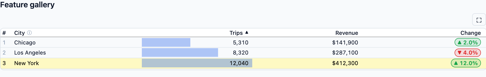

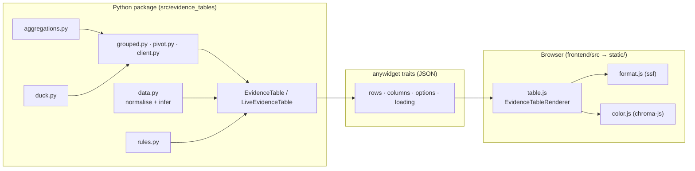

## 2. Repository map

```text
src/evidence_tables/        Python package (the anywidget)
  __init__.py               public API re-exports
  table.py                  EvidenceTable, option keys, column coercion
  data.py                   normalise / infer / jsonify
  grouped.py                grouped_table, decorate_grouped_rows, simple_table
  client.py                 grouped_records (in-memory grouping)
  aggregations.py           built-in + callable aggregations
  pivot.py                  pivot_table
  comparison.py             comparison_table (prior period)
  query.py                  query_table, date_range_sql
  rules.py                  gt-style cells_body / tab_* / sub_* / cols_merge_*
  live.py                   LiveEvidenceTable, query_values
  duck.py                   DuckDB connections, S3, S3 Tables
  _compat.py                soft Arrow/pandas detection
  static/table.js           committed esbuild bundle
  static/table.css          committed stylesheet
frontend/src/               frontend sources
  index.js                  re-exports table.js
  table.js                  renderer + render() entry
  format.js                 formatValue on top of ssf
  color.js                  colour scales on top of chroma-js
  table.css                 styles
frontend/test_*.js          jsdom unit tests
tests/                      pytest unit tests
tests/browser/              Playwright functional tests
notebooks/                  marimo demos (01–20)
```

## 3. The anywidget contract

An anywidget is a Python class whose synced traitlets are mirrored into a model
in the browser, plus an ESM module and CSS:

```python
class EvidenceTable(anywidget.AnyWidget):
    _esm = _ASSET_DIR / "table.js"
    _css = _ASSET_DIR / "table.css"

    rows = traitlets.List(trait=traitlets.Dict(), default_value=[]).tag(sync=True)
    columns = traitlets.List(trait=traitlets.Dict(), default_value=[]).tag(sync=True)
    options = traitlets.Dict(default_value={}).tag(sync=True)
    loading = traitlets.Bool(False).tag(sync=True)
```

The module's default export is `{ render }`. `render` receives `{ model, el }`,
builds the renderer, wires trait changes to re-renders, and returns a cleanup
function:

```js
export function render({ model, el }) {
  el.classList.add("evidence-tables-widget");
  const renderer = new EvidenceTableRenderer(model, el);
  const rerender = () => renderer.render();
  model.on("change:rows", rerender);
  model.on("change:columns", rerender);
  model.on("change:options", rerender);
  model.on("change:loading", () => renderer.setLoading(model.get("loading")));
  return () => { /* off(...) and renderer.destroy() */ };
}
export default { render };
```

Two details matter:

- **`_esm`/`_css` are files** inside the package, so the widget works with no
  JS toolchain at install time. The bundle is committed and rebuilt with
  `make frontend-build`.
- **`render` returns a cleanup function.** anywidget calls it when the widget is
  removed; the renderer removes its DOM, disconnects the `ResizeObserver`, and
  clears timers. Without it, live notebooks leak observers.

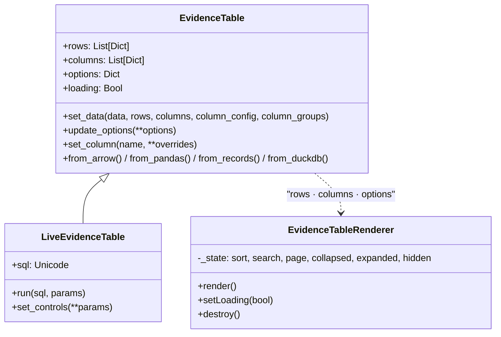

## 4. Python layer

### 4.1 `table.py` — the widget and its schema

`EvidenceTable.__init__` does, in order:

1. Split keyword arguments into known table options (`_OPTION_KEYS`) and the rest
   (forwarded to `AnyWidget`).
2. Normalise `data` (or accept explicit `rows`).
3. Infer columns if none were given.
4. Apply `column_config` blank predicates, then resolve rules.
5. Coerce column definitions and assign column groups.
6. Merge options over `_OPTION_DEFAULTS`.
7. Call `super().__init__(rows=…, columns=…, options=…, loading=…)`.

`_OPTION_KEYS`/`_OPTION_DEFAULTS` are the single source of truth for table-level
options; anything not listed is passed through to anywidget (so widget layout
kwargs still work). Keeping an explicit allow-list means a typo in an option name
is ignored rather than silently synced.

**Evidence compatibility** is handled in `_coerce_column` via two maps:

- `_CONTENT_TYPES` maps Evidence's `contentType` shorthands
  (`sparkline`, `sparkarea`, `sparkbar`, `bar`, `color`, `colorscale`, `delta`,
  `html`, `link`, `image`, `logo`) onto our `viz`/options.
- `_COLUMN_ALIASES` maps camelCase names (`contentType`, `colGroup`,
  `fmtColumn`, `redNegatives`, `linkLabel`, `openInNewTab`, …) onto snake_case.

`_normalize_column_options` folds Evidence's flat options (`color_scale`,
`colorMin`, `sparkY`, `barColor`, …) into nested `color_options`,
`sparkline_options`, `bar_options`, `delta_options`, `image_options`.

`_coerce_columns` merges `column_config`, synthesises template columns that do
not exist in the data (the `cols_merge*` case), and — critically — **drops
Python callables** before the column dict is serialised, because callables
cannot cross the JSON boundary.

### 4.2 `data.py` — normalisation and inference

```python
jsonify(value)          # Decimal→float, datetime→ISO, NaN→None, numpy→Python
normalize_data(data)    # any container → (rows, inferred_columns|None)
infer_columns(data, rows)
make_column(name, type, **overrides)
apply_blank_predicates(rows, column_config)
```

`normalize_data` dispatches on the container type and deliberately keeps Arrow
and pandas as *soft* dependencies (`_compat.is_arrow_table` /
`is_pandas_dataframe` check the module name, so neither import is required):

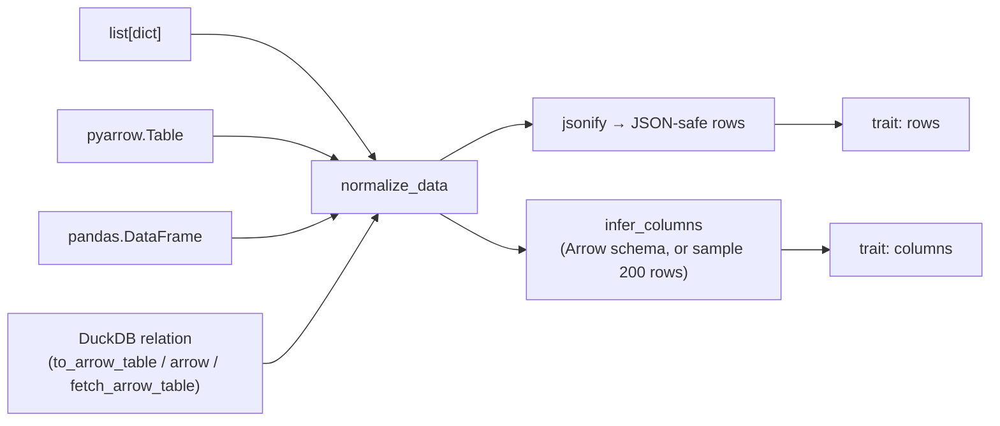

Type inference maps Arrow types (`date`/`timestamp` → `date`, `int`/`float`/
`decimal` → `number`, `list` → `array`, `struct`/`map` → `object`) and otherwise
samples the first 200 values. `apply_blank_predicates` is where a Python
`blank=lambda v: …` becomes a `None` in the rows.

### 4.3 `grouped.py` — subtotals from one query

`grouped_table` parses measures, builds one `GROUPING SETS` query, then hands the
raw rows to `decorate_grouped_rows`:

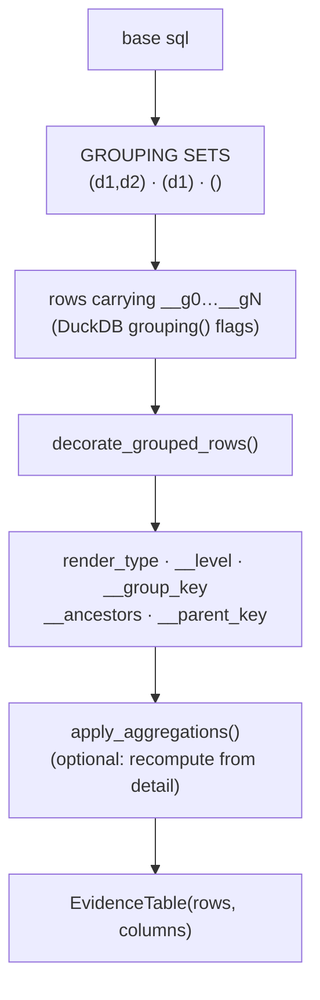

- `_parse_measure` accepts `"sum(x) AS total"`, `(alias, expr)` and
  `{alias: expr}`.
- The SQL uses `grouping(dim) AS __gN` to distinguish a real value from a
  subtotal's blank; `GROUPING SETS` for every prefix of the dimensions plus `()`
  gives all subtotals and the grand total in one pass.
- `decorate_grouped_rows` pops the `__gN` flags, computes `__level`,
  `__group_key` and `__ancestors`, and orders subtotals above/below their group.
- `total_measures` can substitute a different aggregation for the grand total
  (`CASE WHEN grouping(d0)=1 THEN …`).

`simple_table` is the thin wrapper for "just run this SQL".

### 4.4 `client.py` — grouping without a database

`grouped_records` sorts in-memory rows, computes subtotals for each prefix of
`group_by` using `aggregations`, fabricates the same `__gN` flags, and calls the
**same** `decorate_grouped_rows`. The renderer therefore has exactly one
grouping model, whether the rows came from DuckDB or a list.

### 4.5 `aggregations.py` — one path for built-ins and callables

An `Aggregation` is `(values, weights=None) -> value`. Built-ins
(`sum`, `mean`/`avg`, `median`, `min`, `max`, `count`, `count_distinct`,
`weighted_mean`) are just callables in `BUILTIN_AGGREGATIONS`.
`resolve_aggregation` accepts a name or a Python callable and returns the same
signature, so custom functions and built-ins share a path.

`apply_aggregations` walks the decorated rows: a subtotal's descendants are the
detail rows whose `__ancestors` contain the subtotal's `__group_key`; the grand
total uses all detail rows. For `weighted_mean`, `grouped_table` adds hidden
`__w_<alias>` weight-sum columns and passes their values through as weights.

### 4.6 `pivot.py`, `comparison.py`, `query.py` — query builders

These build SQL, run it, and hand rows to `EvidenceTable` (or
`decorate_grouped_rows`).

- `pivot_table` discovers distinct pivot combinations, emits one
  `sum(measure) FILTER (WHERE pivot = …)` column per combination per measure,
  groups those columns under spanners, and reuses the grouped decoration for
  subtotal rows.
- `comparison_table` anchors on the latest `date_column`, computes current and
  prior windows with a two-CTE join, and appends `<m>_prior`, `<m>_delta`,
  `<m>_pct` columns (the last rendered as a `delta`).
- `query_table` wraps a base query with `where`/`qualify`/`order`/`limit`, and
  `date_range_sql` renders Evidence's date-range presets
  (`last 12 months`, `month to date`, `2020-01-01 to 2023-03-01`, …) into a
  DuckDB boolean expression.

### 4.7 `rules.py` — gt-style locations

`cells_body(columns, rows)` returns a location; `tab_style` / `tab_format` /
`text_transform` / `sub_*` / `cols_merge*` return rules. `resolve_rules(rows,
rules)` does the only thing that must happen in Python:

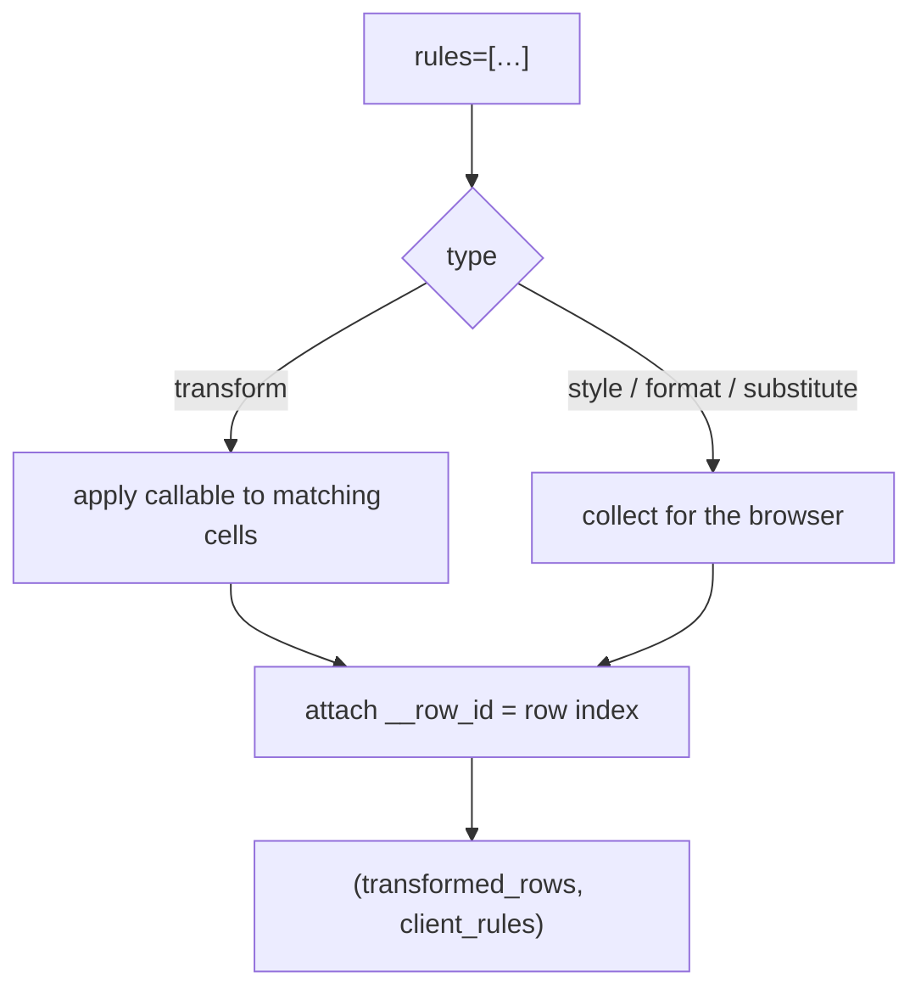

Rows may be a list of 0-based indices **or a predicate** `rows=lambda r: …`.
Predicates are resolved in Python against the *original* order, and each row
gets a stable `__row_id`; the browser matches on `__row_id`, so a rule keeps
pointing at the same row after the user sorts or pages. Style/format/substitute
rules travel as data; the renderer applies them in order (last match wins).

### 4.8 `live.py` — parameterised re-querying

`LiveEvidenceTable` subclasses `EvidenceTable` and adds an `sql` trait. `run()`
prepares the statement, executes it, and calls `set_data`.

`_prepare` handles two template forms and **always binds parameters**:

- PEP 750 t-strings: each interpolation becomes a `?` placeholder.
- Plain strings: `${name}`, `$name` and `{name}` are replaced with `?` and the
  bound values collected positionally.

`set_controls(**params)` updates the parameter map and re-runs. With
`bind_controls=True`, `_bind_controls` chains a re-run handler onto each
control's private `_on_change` (Marimo forbids replacing the public
`on_change` after construction). In Marimo the recommended path is the reactive
cell calling `set_controls`, so the widget instance is never recreated.

`query_values(con, sql)` returns the first column of a query as a list, for
populating dropdowns from dimension queries.

### 4.9 `duck.py` and `_compat.py`

`duck.connect` loads `httpfs`. `configure_s3` builds a DuckDB S3 secret from
boto3/ambient credentials, and `attach_s3_tables` attaches an Iceberg REST
catalog (`TYPE iceberg … AUTHORIZATION_TYPE 'sigv4'`). Neither boto3 nor Arrow
is a hard dependency: `_compat` detects Arrow/pandas by module name so the
package imports and runs without them.

## 5. Wire format

Three traits carry everything. `rows` is a list of dicts; `columns` a list of
column definitions; `options` the table-level settings. A minimal example:

```json
{
  "columns": [
    { "name": "city",    "type": "string", "align": "left" },
    { "name": "revenue", "type": "number", "align": "right",
      "fmt": "usd0", "viz": "bar", "bar_options": {} }
  ],
  "rows": [
    { "city": "New York", "revenue": 412300, "__row_id": 0 }
  ],
  "options": {
    "title": "Tipping by city", "page_size": 15,
    "search": true, "row_shading": true, "freeze_columns": 2
  }
}
```

Rows may additionally carry renderer metadata, all of it underscore-prefixed to
avoid clashing with data columns:

| Field | Set by | Meaning |
| --- | --- | --- |
| `__row_id` | `rules.resolve_rules` | stable identity for style/format rules |
| `render_type` | `grouped.decorate_grouped_rows` | `cell_data` / `row_subtotal` / `row_total` / `row_section` |
| `__level` | `grouped` | depth in the group hierarchy |
| `__group_key` | `grouped` | identity of a subtotal row (for collapse) |
| `__ancestors` | `grouped` | keys of enclosing subtotals (drives aggregations) |
| `__parent_key` | `grouped` | immediate parent |
| `__hide_cell` | callers | per-cell concealment |

`columns` entries are sparse dictionaries: only non-`None` keys are kept
(`make_column` filters them), which keeps the payload small. `loading` is a
separate boolean trait so a live update can dim the table without touching the
rows.

## 6. Render pipeline (JavaScript)

`EvidenceTableRenderer` owns all mutable UI state:

```js
this._state = {
  sort: { column, direction } | null,
  search: "",
  page: 0,
  collapsed: new Set(),   // group keys folded shut
  expanded: new Set(),
  hidden: new Set(),
};
```

`render()` is a full re-render of the table body from the traits plus this
state. It is the only entry point; every interaction mutates `_state` and calls
it. The pipeline is deliberately linear and pure:

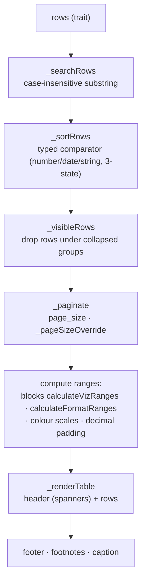

Range computation is done **after** search/sort but **over all matching rows**
(not just the page), so a bar's scale does not change as you page. Colour scales
and auto-format ranges skip subtotal/total rows so a subtotal never distorts the
heatmap.

### 6.1 Cell render pipeline

Each cell is rendered by a fixed sequence of fallbacks, so features compose
without special-casing:

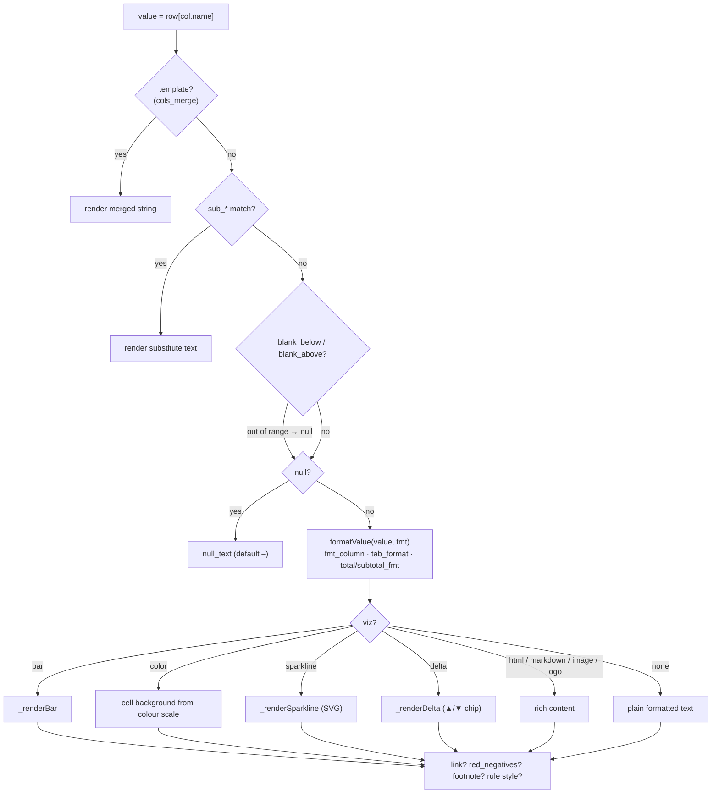

### 6.2 Visualisations

- **Bar** (`_renderBar`). The bar is a positioned div behind a right-aligned
  label. The cell pulls into the cell padding with negative margins and the
  value is pushed back out by the same padding, so the bar can fill the row
  (2px clearance to the separators) and extend past the number for clearance —
  **without changing the row height**. Percentage:

  $$p=\operatorname{clamp}\!\left(\frac{v-m}{M-m},\,0,\,1\right)\times 100$$

  where `[m, M]` is the column range when `fit_to_data` is set, otherwise
  `[min(0, min), max(0, max)]` so bars start at a meaningful zero.
- **Colour** (`calculateColorStyles` + `color.js`). Supports named presets,
  explicit palettes, explicit colour stops, min/max/ midpoint, a separate
  `scale_column`, and `conditional_colors` (a hidden hex column). Text colour is
  chosen by contrast against the background.
- **Sparkline** (`_renderSparkline`). Builds an inline SVG from an array in a
  cell: `[y, …]`, `[[x, y], …]`, or `ARRAY_AGG({'date': …, 'value': …})`
  objects. Line/area/bar, optional zero baseline, tooltips via `<title>`.
- **Delta** (`_renderDelta`). ▲/▼ with a good/bad class, optional chip and
  neutral range, percentage-aware formatting.

### 6.3 `format.js` and `color.js`

`format.js` ports Evidence's `formatValue` on top of `ssf`: preset construction
(currencies, units, decimals, dates), auto-scaling base formats, date
normalisation, Excel serial handling, quarters, and the special formatters
`bytes`/`duration`/`roman`/`flag`.

`color.js` ports Evidence's colour-scale maths on top of `chroma-js`:
`createColorScale` (linear, diverging via midpoint, or explicit stops),
`calculateVizRanges`, `calculateFormatRanges`, `buildColorVizScale`,
`calculateColorStyles`, and `colorStylesFromHex` (contrast-aware text + border).

### 6.4 Grouping, sections and frozen columns

- **Accordion groups** (`group_type="accordion"`, the default): subtotal rows
  render a chevron in their own dimension column; clicking toggles the group key
  in `_state.collapsed`, and `_visibleRows` drops rows whose `__ancestors`
  include a collapsed key. Dimension cells are indented to show nesting
  (Evidence's `getIndentAmount`): detail rows indent their *parent* dimension
  columns but not the leaf, and subtotal rows indent their ancestors.
- **Section groups** (`group_type="section"`): `_computeRowspans` merges each
  subtotal's dimension cell across its members via `rowSpan`, giving the merged
  group cells of a classic sectioned table.
- **Frozen columns**: `_applyFrozenOffsets` measures the first *n* header cells
  and sets cumulative `left` offsets with `position: sticky`, on both header and
  body cells. It runs in `requestAnimationFrame` after every render and on
  resize, because widths depend on layout.

### 6.5 Interaction details

- **Sorting** is 3-state (desc → asc → none) per column, using a typed
  comparator that handles numbers, dates and locale strings.
- **Press-and-hold pagination.** After a 700ms delay the page advances every
  700ms, easing linearly to 100ms by 3s:

  $$I(t)=I_{\text{start}}+(I_{\text{end}}-I_{\text{start}})\cdot
  \operatorname{clamp}\!\left(\frac{t-D}{R},0,1\right)$$

  with $D=700$ms, $I_{\text{start}}=700$ms, $I_{\text{end}}=100$ms,
  $R=2300$ms. A `pointerup`/`pointercancel`/`blur` listener on `window` stops it.
- **CSV download** serialises the current (searched, sorted, visible) rows, not
  just the page.

### 6.6 Fullscreen

⛶ detaches `this.root` from the inline position, appends it to a `<dialog>`,
and calls `showModal()`. A `ResizeObserver` re-fits on resize. The page size is
recomputed from the available height:

$$N=\max\!\left(1,\left\lfloor\frac{H_{\text{avail}}-2}{h_{\text{row}}}\right\rfloor\right)$$

The loop measures the header and first row, renders at the fitted page size, and
repeats up to three times to converge. Closing the dialog (× , Escape, or a
backdrop press — tracked so a drag ending on the backdrop does not dismiss)
restores the inline position and the configured `page_size`. A commented
placeholder node marks the inline position for the move back.

### 6.7 Loading state machine

`setLoading` implements the "don't flash" behaviour. Rows that arrive before
`LOADING_SHOW_DELAY` (180ms) never show the overlay; slower ones fade in
"Processing…" for `FADE_MS` (600ms). A `min-height` baseline measured per page
size keeps the table from jumping.

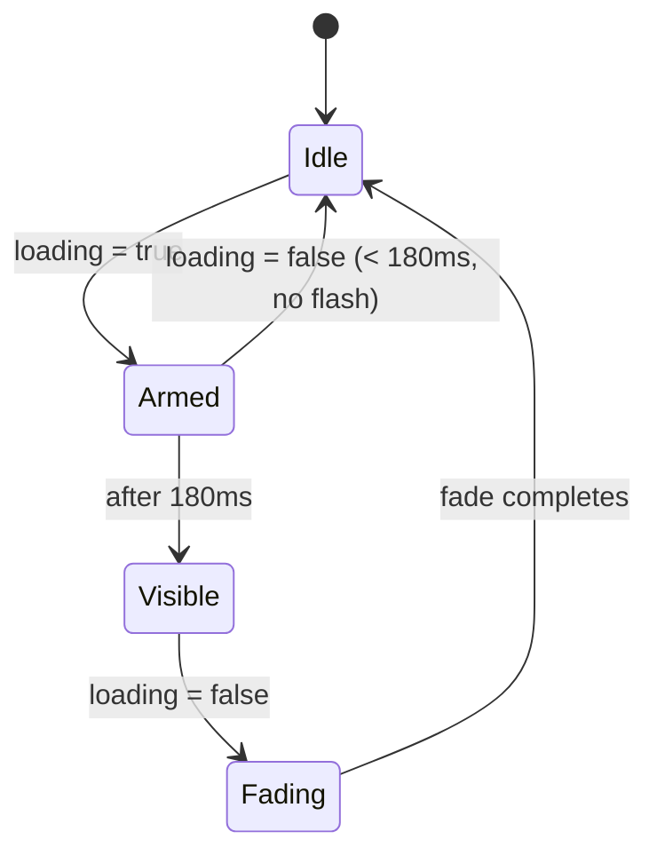

## 7. Live update end-to-end

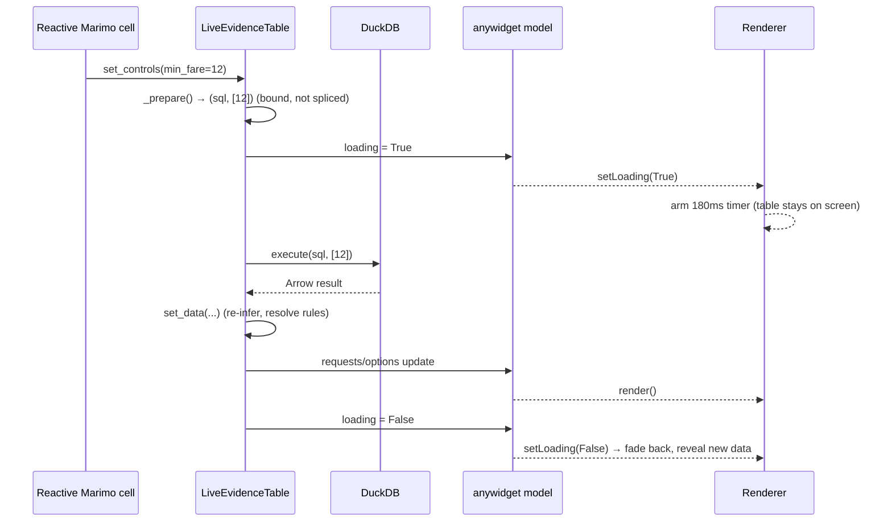

`set_data` only assigns `columns` when the column structure actually changed, so
a data-only update triggers one re-render instead of two.

## 8. Build, bundle and packaging

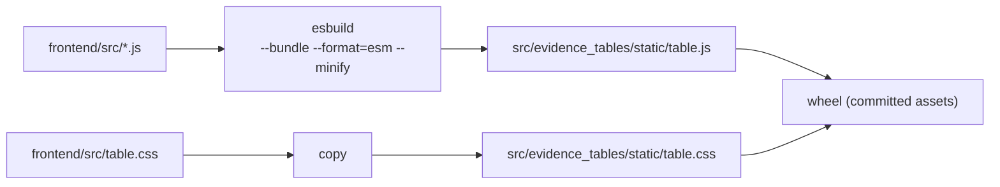

`esbuild` bundles `ssf` and `chroma-js` into one ESM file. The output and the CSS
are **committed**, so the Python package has no JS toolchain requirement. The
build is one `make` target:

```make
frontend-build: ## Bundle the anywidget JavaScript and CSS into the Python package
	cd frontend && npm run build
```

## 9. Testing strategy

Three layers, chosen so that each behaviour is tested at the cheapest level that
can observe it:

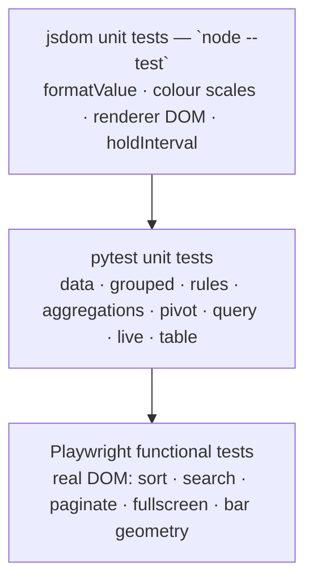

- **jsdom unit tests** (`frontend/test_*.js`) exercise the pure JS:
  formatting, colour maths and renderer output (with a fake model), plus the
  exported `holdInterval` easing.
- **pytest unit tests** (`tests/`) exercise the Python: normalisation,
  inference, SQL generation, rule resolution, aggregation and the live
  parameter binding. They do not need a browser.
- **Playwright tests** (`tests/browser/`) serve the repo over HTTP and drive an
  installed Edge/Chrome (`channel="msedge"`, falling back to Chrome/Chromium)
  against `frontend/preview.html`. They assert the things only a real browser
  can: sort order, search filtering, pagination, fullscreen round-trips,
  sparkline counts, and the exact bar geometry
  (`test_bar_fills_row_without_growing_it` checks the bar fills the padded row
  with 2px clearance and does not grow the row).

`make validate` runs lint, `marimo check` on every notebook, both unit suites,
and builds the wheel. `make test-browser` runs the Playwright suite.

## 10. Performance notes and limits

- **Pagination, not virtualisation.** `page_size` is clamped to 200 rows; the
  renderer builds real DOM. This bounds the per-render cost and memory. Very
  large result sets should be paged or aggregated in SQL.
- **Full re-render.** Every interaction rebuilds the table body. This is simple
  and fast for a page; it is not intended for 10⁴ visible rows.
- **Ranges recompute per render.** `calculateVizRanges` and
  `calculateFormatRanges` scan the searched/sorted rows each time. These are
  O(rows) and cheap for page-sized data; they are the first thing to memoise if
  larger in-memory datasets are needed.
- **ResizeObserver.** Frozen-column offsets and fullscreen fitting react to
  size changes; the observer is disconnected in `destroy()`.

## 11. Extending the widget

- **A new format code or special formatter** — add it in `format.js`
  (`formatValue`'s special cases), and add a JS test.
- **A new visualisation** — add a `_renderX(col, value)` method in `table.js`,
  dispatch it in the cell pipeline (§6.1), and document the column option in
  `README.md` and `_normalize_column_options` if it has Evidence-style flat
  aliases.
- **A new table/column option** — add it to `_OPTION_KEYS`/`_OPTION_DEFAULTS`
  (table options) or to `make_column` (column options), document it, and add a
  notebook demo. No frontend change is needed if the option is pure CSS/data.
- **A new Python helper** — build SQL and hand rows to `EvidenceTable` (or
  `decorate_grouped_rows` if it should have subtotals); re-export it from
  `__init__.py`.

## 12. File-by-file index

| File | Responsibility |
| --- | --- |
| `table.py` | `EvidenceTable`, option schema, column coercion, groups |
| `data.py` | normalisation, JSON safety, type inference, blank predicates |
| `grouped.py` | `grouped_table`, `decorate_grouped_rows`, `simple_table` |
| `client.py` | `grouped_records` (in-memory grouping) |
| `aggregations.py` | built-in + callable aggregations |
| `pivot.py` | `pivot_table` |
| `comparison.py` | `comparison_table` |
| `query.py` | `query_table`, `date_range_sql` |
| `rules.py` | `cells_body`, `tab_*`, `sub_*`, `cols_merge*`, `resolve_rules` |
| `live.py` | `LiveEvidenceTable`, `query_values` |
| `duck.py` | DuckDB connections, S3, S3 Tables |
| `_compat.py` | soft Arrow/pandas detection |
| `table.js` | renderer, pipeline, interaction, fullscreen, CSV |
| `format.js` | `formatValue` on `ssf` |
| `color.js` | colour scales on `chroma-js` |
| `table.css` | styles, including the bar geometry |
